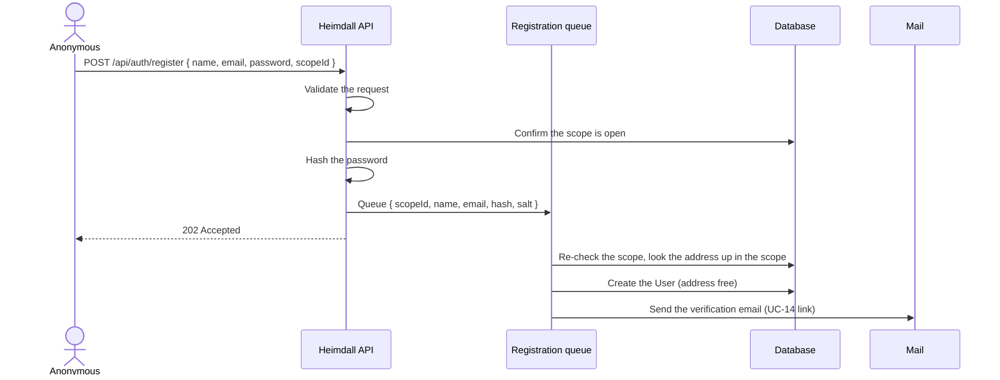

# Self-Service Sign-Up — Plan 1 of 3: heimdall-api

> **For agentic workers:** REQUIRED SUB-SKILL: Use superpowers:subagent-driven-development (recommended) or superpowers:executing-plans to implement this plan task-by-task. Steps use checkbox (`- [ ]`) syntax for tracking.

**Goal:** Let an anonymous caller register a password `User` in a scope whose owner has opened self-registration, answering identically for new and taken addresses.

**Architecture:** A per-scope `SelfRegistrationEnabled` flag (default off) toggled like `GoogleSignInEnabled`. `POST /api/auth/register` validates, checks the scope, hashes the password, queues a `RegistrationRequest` and answers `202`. A background `RegistrationDispatcher` runs `RegistrationProcessor` per request: it creates the person and sends the verification email, or emails the existing owner about the attempt. This mirrors UC-12's `PasswordRecoveryQueue` → `PasswordRecoveryDispatcher` → `PasswordRecoveryProcessor` exactly.

**Tech Stack:** .NET 10, ASP.NET Core, EF Core (PostgreSQL), FluentValidation, ArturRios.Mediator, xUnit + Moq + `ArturRios.Util.Test` (`[UnitFact]`, `[FunctionalFact]`, `AsyncFakeRepository`), Testcontainers.

**Spec:** `D:\Repositories\fortuna-ui\docs\superpowers\specs\2026-10-12-self-service-sign-up-design.md` (§4).

**Repository:** `D:\Repositories\heimdall-api`. Every path below is relative to it.

## Global Constraints

- Branch: `feature/self-service-sign-up` from an up-to-date `develop` (`git pull` first — local `develop` was 2 behind `origin/develop` on 2026-10-12). Leave the unrelated `docs/themes/docsy` submodule change alone.
- Commit subjects: lowercase Conventional Commits (`feat:`, `test:`, `docs:`, `build:`), ≤ 50 chars, imperative; end every commit message with `Co-Authored-By: Claude Opus 5.5 <noreply@anthropic.com>`.
- Test names: `GivenX_WhenY_ThenZ`; every test carries `[UnitFact]` or `[FunctionalFact]`.
- Name rules: required, ≤ 200 chars. Email: required, valid address. Password: required, ≥ 8 chars. Shared with `CreateUserCommandValidator`, not copied.
- The response to a valid register request against an open scope is **`202`** with **exactly** `"If this address can be registered, we've sent it an email. Follow it, then sign in."` — for every address.
- A missing, deleted or closed scope answers **`403`** with **exactly** `"This instance is not accepting new accounts."`
- The plaintext password never enters the queue, a log line, or a response.
- New flag defaults to `false`; existing scopes stay closed.
- Use case: **UC-47: Register a Password User**. Requirements: new group **FR-SR-01 … FR-SR-06**.

## Review Focus

1. **A second registration of the same new address** (double-click, retry) — the person is created once; the second request mails the attempt notice instead of creating a duplicate or crashing. Pinned in Task 5.
2. **An address taken by a restricted person (NFR-24)** — no email at all, since mailing a restricted identity is processing it. Pinned in Task 4.
3. **The scope is closed between the request and the processing** — nothing is created. Pinned in Task 4.
4. **Email differing only in case or surrounding whitespace from an existing one** — treated as taken. Pinned in Task 4 (case) and Task 3 (trim before queueing).
5. **The queue is full** — the answer is unchanged. Pinned in Task 3.

---

### Task 1: Scope flag and its toggle

**Files:**
- Modify: `src/Domain/ArturRios.Heimdall.Domain/Entities/Scope.cs`
- Modify: `src/Infrastructure/ArturRios.Heimdall.Data/EntityMaps/ScopeDbMap.cs`
- Create: migration `src/Infrastructure/ArturRios.Heimdall.Data/Migrations/<timestamp>_AddScopeSelfRegistration.cs` (generated)
- Modify: `src/Application/ArturRios.Heimdall.Query/Output/ScopeOutput.cs`, `src/Application/ArturRios.Heimdall.Query/Handlers/GetScopeByIdQueryHandler.cs`, `src/Application/ArturRios.Heimdall.Query/Handlers/ListScopesQueryHandler.cs`
- Modify: `src/Application/ArturRios.Heimdall.Command/Output/CreateScopeCommandOutput.cs`, `UpdateScopeCommandOutput.cs`, `src/Application/ArturRios.Heimdall.Command/Handlers/CreateScopeCommandHandler.cs`, `UpdateScopeCommandHandler.cs`
- Create: `src/Application/ArturRios.Heimdall.Command/Input/SetSelfRegistrationCommand.cs`
- Create: `src/Application/ArturRios.Heimdall.Command/Input/Validation/SetSelfRegistrationCommandValidator.cs`
- Create: `src/Application/ArturRios.Heimdall.Command/Output/SetSelfRegistrationCommandOutput.cs`
- Create: `src/Application/ArturRios.Heimdall.Command/Handlers/SetSelfRegistrationCommandHandler.cs`
- Modify: `src/Application/ArturRios.Heimdall.Shared/Messages/ScopeMessages.cs`, `ScopeMessageMap.cs`
- Modify: `src/Presentation/ArturRios.Heimdall.WebApi/Controllers/ScopeController.cs`, `Startup.cs`
- Test: `tests/Application/ArturRios.Heimdall.Command.Tests/SetSelfRegistrationCommandHandlerTests.cs`
- Test: `tests/Presentation/ArturRios.Heimdall.WebApi.Tests/ScopeControllerSetSelfRegistrationTests.cs`

**Interfaces:**
- Produces: `Scope.SelfRegistrationEnabled : bool`; `PUT /api/scopes/{id}/self-registration` with body `{ "enabled": bool }`; `ScopeMessages.SelfRegistrationUpdatedSuccessfully`.

- [ ] **Step 1: Add the flag to the entity and map**

In `Scope.cs`, directly after `GoogleSignInEnabled`:

```csharp
    /// <summary>
    ///     Whether anonymous callers may register a password <c>User</c> in this scope (UC-47,
    ///     FR-SR-01). Defaults to <c>false</c>; only the scope's owners or a System Admin may toggle it.
    /// </summary>
    public bool SelfRegistrationEnabled { get; set; }
```

In `ScopeDbMap.cs`, after the `GoogleSignInEnabled` line:

```csharp
        scope.Property(x => x.SelfRegistrationEnabled).HasDefaultValue(false);
```

- [ ] **Step 2: Generate the migration**

Run `dotnet tool restore` once, then `python scripts/migrations.py`, choose the local environment file, choose **create**, and name it `AddScopeSelfRegistration`. If running non-interactively, export that environment file's variables and run:

```bash
dotnet ef migrations add AddScopeSelfRegistration --output-dir Migrations --project src/Infrastructure/ArturRios.Heimdall.Data --startup-project src/Presentation/ArturRios.Heimdall.WebApi
```

Expected: a migration whose `Up` adds `SelfRegistrationEnabled boolean NOT NULL DEFAULT false` to `scope`, and whose `Down` drops it. Open it and confirm nothing else changed.

- [ ] **Step 3: Expose the flag on scope outputs**

Add to `ScopeOutput`, `CreateScopeCommandOutput` and `UpdateScopeCommandOutput`, after `GoogleSignInEnabled`:

```csharp
    /// <summary>Whether anonymous self-registration is open for the scope (UC-47).</summary>
    public bool SelfRegistrationEnabled { get; set; }
```

In each of `GetScopeByIdQueryHandler`, `ListScopesQueryHandler`, `CreateScopeCommandHandler` and `UpdateScopeCommandHandler`, add the following next to the existing `GoogleSignInEnabled = …` assignment, using the same source variable that line uses (`x` or `scope`):

```csharp
                SelfRegistrationEnabled = x.SelfRegistrationEnabled,
```

- [ ] **Step 4: Add the messages**

In `ScopeMessages.cs`, after `GoogleSignInUpdatedSuccessfully`:

```csharp
    public const string SelfRegistrationUpdatedSuccessfully = "Self-registration setting updated successfully.";
```

In `ScopeMessageMap.cs`, after the `GoogleSignInUpdatedSuccessfully` entry:

```csharp
            // UC-47 toggle main flow — self-registration opened or closed. Shares ScopeNotFound (404),
            // NotScopeOwner and EnabledRequired (400) with UC-24.
            [ScopeMessages.SelfRegistrationUpdatedSuccessfully] = HttpStatusCodes.Ok,
```

- [ ] **Step 5: Write the failing handler tests**

Create `tests/Application/ArturRios.Heimdall.Command.Tests/SetSelfRegistrationCommandHandlerTests.cs`:

```csharp
using ArturRios.Heimdall.Command.Handlers;
using ArturRios.Heimdall.Command.Input;
using ArturRios.Heimdall.Command.Input.Validation;
using ArturRios.Heimdall.Domain.Entities;
using ArturRios.Heimdall.Domain.Enums;
using ArturRios.Heimdall.Shared.Messages;
using ArturRios.Heimdall.Shared.Services;
using ArturRios.Util.Test.Attributes;
using ArturRios.Util.Test.Mock;
using Moq;

namespace ArturRios.Heimdall.Command.Tests;

// Unit tests for SetSelfRegistrationCommandHandler (UC-47 toggle, FR-SR-02): the same rules as UC-24's
// Google toggle — the value must be stated, the scope must be live, a Scope Admin must own it.
public class SetSelfRegistrationCommandHandlerTests
{
    private static IScopeOwnershipChecker OwnershipChecker(bool allowed = true)
    {
        var checker = new Mock<IScopeOwnershipChecker>();
        checker
            .Setup(c => c.ActorMayManageScopeAsync(It.IsAny<int>(), It.IsAny<Guid>(), It.IsAny<long>()))
            .ReturnsAsync(allowed);
        return checker.Object;
    }

    private static async Task<(AsyncFakeRepository<Scope, long> scopes, Scope scope)> ScopeStoreAsync(
        bool isDeleted = false, bool selfRegistrationEnabled = false)
    {
        var scopes = new AsyncFakeRepository<Scope, long>();
        var scope = new Scope
        {
            PublicId = Guid.NewGuid(), Name = "Acme", IsDeleted = isDeleted,
            SelfRegistrationEnabled = selfRegistrationEnabled
        };
        await scopes.CreateAsync(scope);
        return (scopes, scope);
    }

    private static SetSelfRegistrationCommandHandler Handler(
        AsyncFakeRepository<Scope, long> scopes, bool ownershipAllowed = true) =>
        new(new SetSelfRegistrationCommandValidator(), scopes, scopes, OwnershipChecker(ownershipAllowed));

    private static SetSelfRegistrationCommand Command(Guid scopeId, bool? enabled) => new()
    {
        Id = scopeId, Enabled = enabled, ActingRole = (int)Roles.SystemAdmin, ActingPersonId = Guid.NewGuid()
    };

    [UnitFact]
    public async Task GivenAClosedScope_WhenEnabling_ThenFlagIsOnAndReturned()
    {
        var (scopes, scope) = await ScopeStoreAsync();

        var output = await Handler(scopes).HandleAsync(Command(scope.PublicId, enabled: true));

        Assert.True(output.Success);
        Assert.Contains(ScopeMessages.SelfRegistrationUpdatedSuccessfully, output.Messages);
        Assert.True(output.Data!.SelfRegistrationEnabled);
        Assert.True(scopes.Query().Single().SelfRegistrationEnabled);
    }

    [UnitFact]
    public async Task GivenAnOpenScope_WhenDisabling_ThenFlagIsOff()
    {
        var (scopes, scope) = await ScopeStoreAsync(selfRegistrationEnabled: true);

        var output = await Handler(scopes).HandleAsync(Command(scope.PublicId, enabled: false));

        Assert.True(output.Success);
        Assert.False(scopes.Query().Single().SelfRegistrationEnabled);
    }

    [UnitFact]
    public async Task GivenNoEnabledValue_WhenHandling_ThenEnabledRequiredAndFlagUnchanged()
    {
        var (scopes, scope) = await ScopeStoreAsync(selfRegistrationEnabled: true);

        var output = await Handler(scopes).HandleAsync(Command(scope.PublicId, enabled: null));

        Assert.False(output.Success);
        Assert.Contains(ScopeMessages.EnabledRequired, output.Errors);
        Assert.True(scopes.Query().Single().SelfRegistrationEnabled);
    }

    [UnitFact]
    public async Task GivenADeletedScope_WhenHandling_ThenScopeNotFound()
    {
        var (scopes, scope) = await ScopeStoreAsync(isDeleted: true);

        var output = await Handler(scopes).HandleAsync(Command(scope.PublicId, enabled: true));

        Assert.Contains(ScopeMessages.ScopeNotFound, output.Errors);
        Assert.False(scopes.Query().Single().SelfRegistrationEnabled);
    }

    [UnitFact]
    public async Task GivenAScopeAdminWhoDoesNotOwnTheScope_WhenHandling_ThenNotScopeOwnerAndFlagUnchanged()
    {
        var (scopes, scope) = await ScopeStoreAsync();

        var output = await Handler(scopes, ownershipAllowed: false)
            .HandleAsync(Command(scope.PublicId, enabled: true));

        Assert.Contains(ScopeMessages.NotScopeOwner, output.Errors);
        Assert.False(scopes.Query().Single().SelfRegistrationEnabled);
    }
}
```

- [ ] **Step 6: Run them to verify they fail**

Run: `dotnet test tests/Application/ArturRios.Heimdall.Command.Tests --filter "FullyQualifiedName~SetSelfRegistrationCommandHandlerTests"`
Expected: build FAILS — `SetSelfRegistrationCommandHandler` does not exist.

- [ ] **Step 7: Implement command, validator, output and handler**

`Input/SetSelfRegistrationCommand.cs`:

```csharp
using System.Text.Json.Serialization;
using ArturRios.Heimdall.Shared.Security;
using ArturRios.Mediator.Command;

namespace ArturRios.Heimdall.Command.Input;

/// <summary>
///     Intent to open or close self-registration for a scope (UC-47 toggle, FR-SR-02). Shaped exactly
///     like <see cref="SetGoogleSignInCommand" />, for the same reasons: the scope comes from the route,
///     the actor from the token, and <see cref="Enabled" /> is nullable so a body omitting it is a 400
///     rather than a silent close.
/// </summary>
public class SetSelfRegistrationCommand : BaseCommand, IActorScoped
{
    [JsonIgnore]
    public Guid Id { get; set; }

    public bool? Enabled { get; set; }

    [JsonIgnore]
    public Guid ActingPersonId { get; set; }

    [JsonIgnore]
    public int ActingRole { get; set; }
}
```

`Input/Validation/SetSelfRegistrationCommandValidator.cs`:

```csharp
using ArturRios.Heimdall.Shared.Messages;
using FluentValidation;

namespace ArturRios.Heimdall.Command.Input.Validation;

/// <summary>Shape validation for <see cref="SetSelfRegistrationCommand" /> (UC-47 toggle).</summary>
public class SetSelfRegistrationCommandValidator : AbstractValidator<SetSelfRegistrationCommand>
{
    public SetSelfRegistrationCommandValidator()
    {
        RuleFor(command => command.Enabled)
            .NotNull()
            .WithMessage(ScopeMessages.EnabledRequired);
    }
}
```

`Output/SetSelfRegistrationCommandOutput.cs`:

```csharp
using ArturRios.Mediator.Command;

namespace ArturRios.Heimdall.Command.Output;

/// <summary>The scope as updated by <see cref="Input.SetSelfRegistrationCommand" /> (UC-47 toggle).</summary>
public class SetSelfRegistrationCommandOutput : CommandOutput
{
    public Guid Id { get; set; }

    public string Name { get; set; } = string.Empty;

    public string? Description { get; set; }

    public bool GoogleSignInEnabled { get; set; }

    public bool SelfRegistrationEnabled { get; set; }

    public IEnumerable<Guid> OwnerIds { get; set; } = new List<Guid>();

    public DateTime CreatedAt { get; set; }

    public DateTime UpdatedAt { get; set; }
}
```

`Handlers/SetSelfRegistrationCommandHandler.cs`:

```csharp
using ArturRios.Data.Relational.Core.Interfaces;
using ArturRios.Heimdall.Command.Input;
using ArturRios.Heimdall.Command.Output;
using ArturRios.Heimdall.Domain.Entities;
using ArturRios.Heimdall.Shared.Messages;
using ArturRios.Heimdall.Shared.Services;
using ArturRios.Mediator.Command.Interfaces;
using ArturRios.Output;
using FluentValidation;
using Microsoft.EntityFrameworkCore;

namespace ArturRios.Heimdall.Command.Handlers;

/// <summary>
///     Handles <see cref="SetSelfRegistrationCommand" /> (UC-47 toggle, FR-SR-02): the same order of
///     checks as <see cref="SetGoogleSignInCommandHandler" /> — the value is stated, the scope is live,
///     a Scope Admin actor owns it — then writes <c>SelfRegistrationEnabled</c> and returns the scope.
/// </summary>
public class SetSelfRegistrationCommandHandler(
    IValidator<SetSelfRegistrationCommand> validator,
    IAsyncReadOnlyRepository<Scope, long> scopeReader,
    IAsyncRepository<Scope, long> scopeWriter,
    IScopeOwnershipChecker scopeOwnership)
    : ICommandHandlerAsync<SetSelfRegistrationCommand, SetSelfRegistrationCommandOutput>
{
    public async Task<DataOutput<SetSelfRegistrationCommandOutput?>> HandleAsync(
        SetSelfRegistrationCommand command, CancellationToken cancellationToken = default)
    {
        var output = DataOutput<SetSelfRegistrationCommandOutput?>.New;

        var validation = await validator.ValidateAsync(command, cancellationToken);

        if (!validation.IsValid)
        {
            return output.WithErrors(validation.Errors.Select(failure => failure.ErrorMessage));
        }

        var scope = await scopeReader.Query()
            .FirstOrDefaultAsync(x => x.PublicId == command.Id && !x.IsDeleted, cancellationToken);

        if (scope is null)
        {
            return output.WithError(ScopeMessages.ScopeNotFound);
        }

        if (!await scopeOwnership.ActorMayManageScopeAsync(command.ActingRole, command.ActingPersonId, scope.Id))
        {
            return output.WithError(ScopeMessages.NotScopeOwner);
        }

        var ownerIds = await scopeReader.Query()
            .Where(x => x.PublicId == command.Id)
            .SelectMany(x => x.Owners.Select(owner => owner.Person.PublicId))
            .ToListAsync(cancellationToken);

        scope.SelfRegistrationEnabled = command.Enabled!.Value;
        scope.UpdatedAt = DateTime.UtcNow;

        var update = await scopeWriter.UpdateAsync(scope);

        if (!update.Success)
        {
            return output.WithErrors(update.Errors);
        }

        return output
            .WithData(new SetSelfRegistrationCommandOutput
            {
                Id = scope.PublicId,
                Name = scope.Name,
                Description = scope.Description,
                GoogleSignInEnabled = scope.GoogleSignInEnabled,
                SelfRegistrationEnabled = scope.SelfRegistrationEnabled,
                OwnerIds = ownerIds,
                CreatedAt = scope.CreatedAt,
                UpdatedAt = scope.UpdatedAt
            })
            .WithMessage(ScopeMessages.SelfRegistrationUpdatedSuccessfully);
    }
}
```

- [ ] **Step 8: Run the handler tests to verify they pass**

Run: `dotnet test tests/Application/ArturRios.Heimdall.Command.Tests --filter "FullyQualifiedName~SetSelfRegistrationCommandHandlerTests"`
Expected: 5 passed.

- [ ] **Step 9: Wire the endpoint and registration**

In `Startup.cs`, directly after the two `SetGoogleSignInCommand` lines (~L231-232):

```csharp
        Builder.Services.AddScoped<IValidator<SetSelfRegistrationCommand>, SetSelfRegistrationCommandValidator>();
        Builder.Services.AddAuditedCommandHandler<SetSelfRegistrationCommand, SetSelfRegistrationCommandOutput, SetSelfRegistrationCommandHandler>();
```

In `ScopeController.cs`, directly after the `SetGoogleSignIn` action:

```csharp
    /// <summary>
    ///     Opens or closes anonymous self-registration for a scope (UC-47 toggle, FR-SR-02). Same
    ///     actors and refusals as <see cref="SetGoogleSignIn" />.
    /// </summary>
    [HttpPut("{id:guid}/self-registration")]
    [RoleRequirement((int)Roles.SystemAdmin, (int)Roles.ScopeAdmin)]
    public async Task<ActionResult<DataOutput<SetSelfRegistrationCommandOutput?>>> SetSelfRegistration(
        Guid id, [FromBody] SetSelfRegistrationCommand command)
    {
        command.Id = id;
        HttpContext.ApplyActor(command);

        var result = await commandMediator
            .ExecuteCommandAsync<SetSelfRegistrationCommand, SetSelfRegistrationCommandOutput>(command);

        return result.ToActionResult(statusMap: ScopeMessageMap.StatusCodes);
    }
```

- [ ] **Step 10: Write the functional tests**

Create `tests/Presentation/ArturRios.Heimdall.WebApi.Tests/ScopeControllerSetSelfRegistrationTests.cs`:

```csharp
using System.Net;
using ArturRios.Configuration.Enums;
using ArturRios.Heimdall.Command.Output;
using ArturRios.Heimdall.Domain.Entities;
using ArturRios.Heimdall.Domain.Enums;
using ArturRios.Heimdall.Shared.Messages;
using ArturRios.Heimdall.WebApi.Tests.Support;
using ArturRios.Output;
using ArturRios.Util.Http;
using ArturRios.Util.Test.Attributes;
using ArturRios.Util.Test.Functional;
using Microsoft.EntityFrameworkCore;

namespace ArturRios.Heimdall.WebApi.Tests;

// Functional tests for PUT /api/scopes/{id}/self-registration (UC-47 toggle, FR-SR-02). The rules are
// the handler's and are unit-tested there; these pin the route, the role requirement and persistence.
[Collection(nameof(FunctionalCollection))]
public class ScopeControllerSetSelfRegistrationTests(PostgresFixture db) : WebApiTest<Program>(EnvironmentType.Local)
{
    private static string Route(Guid scopeId) => $"/api/scopes/{scopeId}/self-registration";

    private Task<HttpOutput<DataOutput<SetSelfRegistrationCommandOutput?>?>> SetAsync(Guid scopeId, bool enabled) =>
        Gateway.PutAsync<DataOutput<SetSelfRegistrationCommandOutput?>>(Route(scopeId), new { enabled });

    private async Task<Scope> SeedScopeAsync()
    {
        await using var context = db.CreateContext();
        var scope = new Scope { PublicId = Guid.NewGuid(), Name = $"scope-{Guid.NewGuid():N}" };
        context.Scopes.Add(scope);
        await context.SaveChangesAsync();
        return scope;
    }

    private async Task<bool> PersistedFlagAsync(Scope scope)
    {
        await using var context = db.CreateContext();
        var persisted = await context.Scopes.AsNoTracking().FirstAsync(x => x.PublicId == scope.PublicId);
        return persisted.SelfRegistrationEnabled;
    }

    [FunctionalFact]
    public async Task GivenANewScope_WhenReadingItsFlag_ThenSelfRegistrationIsClosed()
    {
        var scope = await SeedScopeAsync();

        Assert.False(await PersistedFlagAsync(scope));
    }

    [FunctionalFact]
    public async Task GivenSystemAdmin_WhenPutSelfRegistrationEnabled_ThenOkAndFlagIsOn()
    {
        var scope = await SeedScopeAsync();
        Authorize(TestTokens.ForRole((int)Roles.SystemAdmin));

        var response = await SetAsync(scope.PublicId, enabled: true);

        Assert.Equal(HttpStatusCode.OK, response.StatusCode);
        Assert.True(response.Body!.Data!.SelfRegistrationEnabled);
        Assert.Contains(ScopeMessages.SelfRegistrationUpdatedSuccessfully, response.Body.Messages);
        Assert.True(await PersistedFlagAsync(scope));
    }

    [FunctionalFact]
    public async Task GivenAUser_WhenPutSelfRegistration_ThenForbiddenAndFlagUnchanged()
    {
        var scope = await SeedScopeAsync();
        Authorize(TestTokens.ForRole((int)Roles.User));

        var response = await SetAsync(scope.PublicId, enabled: true);

        Assert.Equal(HttpStatusCode.Forbidden, response.StatusCode);
        Assert.False(await PersistedFlagAsync(scope));
    }
}
```

- [ ] **Step 11: Run the functional tests (Docker must be running)**

Run: `dotnet test tests/Presentation/ArturRios.Heimdall.WebApi.Tests --filter "FullyQualifiedName~ScopeControllerSetSelfRegistrationTests"`
Expected: 3 passed.

- [ ] **Step 12: Commit**

```bash
git add src tests
git commit -m "feat: add per-scope self-registration flag" -m "Co-Authored-By: Claude Opus 5.5 <noreply@anthropic.com>"
```

---

### Task 2: Shared person field rules and the register command

**Files:**
- Create: `src/Application/ArturRios.Heimdall.Command/Input/Validation/PersonFieldRules.cs`
- Modify: `src/Application/ArturRios.Heimdall.Command/Input/Validation/CreateUserCommandValidator.cs`
- Create: `src/Application/ArturRios.Heimdall.Command/Input/RegisterCommand.cs`
- Create: `src/Application/ArturRios.Heimdall.Command/Input/Validation/RegisterCommandValidator.cs`
- Create: `src/Application/ArturRios.Heimdall.Command/Output/RegisterCommandOutput.cs`
- Modify: `src/Application/ArturRios.Heimdall.Shared/Messages/AuthMessages.cs`, `AuthMessageMap.cs`
- Test: `tests/Application/ArturRios.Heimdall.Command.Tests/RegisterCommandValidatorTests.cs`

**Interfaces:**
- Produces: `RegisterCommand { Name, Email, Password, ScopeId (Guid?) }`; `RegisterCommandOutput` (empty); `AuthMessages.RegistrationRequested`, `AuthMessages.RegistrationUnavailable`, `AuthMessages.ScopeRequired`; extension methods `PersonName()`, `PersonEmail()`, `PersonPassword()` on `IRuleBuilder<T, string>`.

- [ ] **Step 1: Write the failing validator tests**

Create `tests/Application/ArturRios.Heimdall.Command.Tests/RegisterCommandValidatorTests.cs`:

```csharp
using ArturRios.Heimdall.Command.Input;
using ArturRios.Heimdall.Command.Input.Validation;
using ArturRios.Heimdall.Shared.Messages;
using ArturRios.Util.Test.Attributes;

namespace ArturRios.Heimdall.Command.Tests;

// Unit tests for RegisterCommandValidator (UC-47, FR-SR-03): the CreateUserCommand field rules, plus a
// scope. Boundaries are tested on both sides.
public class RegisterCommandValidatorTests
{
    private static RegisterCommand Valid() => new()
    {
        Name = "New Person", Email = "new@test.local", Password = "12345678", ScopeId = Guid.NewGuid()
    };

    private static IEnumerable<string> ErrorsFor(RegisterCommand command) =>
        new RegisterCommandValidator().Validate(command).Errors.Select(error => error.ErrorMessage);

    [UnitFact]
    public void GivenAValidCommand_WhenValidating_ThenThereAreNoErrors() =>
        Assert.Empty(ErrorsFor(Valid()));

    [UnitFact]
    public void GivenANameOf200Characters_WhenValidating_ThenItIsAccepted()
    {
        var command = Valid();
        command.Name = new string('a', 200);

        Assert.Empty(ErrorsFor(command));
    }

    [UnitFact]
    public void GivenANameOf201Characters_WhenValidating_ThenNameTooLong()
    {
        var command = Valid();
        command.Name = new string('a', 201);

        Assert.Contains(PersonMessages.NameTooLong, ErrorsFor(command));
    }

    [UnitFact]
    public void GivenAnEmptyName_WhenValidating_ThenNameRequired()
    {
        var command = Valid();
        command.Name = "";

        Assert.Contains(PersonMessages.NameRequired, ErrorsFor(command));
    }

    [UnitFact]
    public void GivenAMalformedEmail_WhenValidating_ThenEmailInvalid()
    {
        var command = Valid();
        command.Email = "not-an-address";

        Assert.Contains(PersonMessages.EmailInvalid, ErrorsFor(command));
    }

    [UnitFact]
    public void GivenASevenCharacterPassword_WhenValidating_ThenPasswordTooShort()
    {
        var command = Valid();
        command.Password = "1234567";

        Assert.Contains(PersonMessages.PasswordTooShort, ErrorsFor(command));
    }

    [UnitFact]
    public void GivenNoScope_WhenValidating_ThenScopeRequired()
    {
        var command = Valid();
        command.ScopeId = null;

        Assert.Contains(AuthMessages.ScopeRequired, ErrorsFor(command));
    }
}
```

- [ ] **Step 2: Run them to verify they fail**

Run: `dotnet test tests/Application/ArturRios.Heimdall.Command.Tests --filter "FullyQualifiedName~RegisterCommandValidatorTests"`
Expected: build FAILS — `RegisterCommand` does not exist.

- [ ] **Step 3: Extract the shared field rules**

`Input/Validation/PersonFieldRules.cs`:

```csharp
using ArturRios.Heimdall.Shared.Messages;
using FluentValidation;

namespace ArturRios.Heimdall.Command.Input.Validation;

/// <summary>
///     The field rules for a password person, shared by every command that creates one (UC-06 path a,
///     UC-47), so an administrator and a self-registering caller can never be held to different rules.
/// </summary>
public static class PersonFieldRules
{
    public static IRuleBuilderOptions<T, string> PersonName<T>(this IRuleBuilder<T, string> rule) =>
        rule.NotEmpty().WithMessage(PersonMessages.NameRequired)
            .MaximumLength(200).WithMessage(PersonMessages.NameTooLong);

    public static IRuleBuilderOptions<T, string> PersonEmail<T>(this IRuleBuilder<T, string> rule) =>
        rule.NotEmpty().WithMessage(PersonMessages.EmailRequired)
            .EmailAddress().WithMessage(PersonMessages.EmailInvalid);

    public static IRuleBuilderOptions<T, string> PersonPassword<T>(this IRuleBuilder<T, string> rule) =>
        rule.NotEmpty().WithMessage(PersonMessages.PasswordRequired)
            .MinimumLength(8).WithMessage(PersonMessages.PasswordTooShort);
}
```

Replace the constructor body of `CreateUserCommandValidator` with:

```csharp
        RuleFor(command => command.Name).PersonName();
        RuleFor(command => command.Email).PersonEmail();
        RuleFor(command => command.Password).PersonPassword();
```

- [ ] **Step 4: Add the command, output, validator and messages**

`Input/RegisterCommand.cs`:

```csharp
using ArturRios.Mediator.Command;

namespace ArturRios.Heimdall.Command.Input;

/// <summary>
///     Intent to register a password <c>User</c> in a scope without an administrator (UC-47,
///     FR-SR-03). Anonymous: nothing here is bound from a token. <see cref="ScopeId" /> is nullable
///     so a body that omits it is refused by the validator instead of binding <c>Guid.Empty</c>.
/// </summary>
public class RegisterCommand : BaseCommand
{
    public string Name { get; set; } = string.Empty;

    public string Email { get; set; } = string.Empty;

    public string Password { get; set; } = string.Empty;

    public Guid? ScopeId { get; set; }
}
```

`Output/RegisterCommandOutput.cs`:

```csharp
using ArturRios.Mediator.Command;

namespace ArturRios.Heimdall.Command.Output;

/// <summary>
///     Result of <see cref="Input.RegisterCommand" /> (UC-47). Deliberately empty, for the reason
///     <see cref="PasswordRecoveryCommandOutput" /> is: any field describing what happened would say
///     whether the address was already taken.
/// </summary>
public class RegisterCommandOutput : CommandOutput;
```

`Input/Validation/RegisterCommandValidator.cs`:

```csharp
using ArturRios.Heimdall.Shared.Messages;
using FluentValidation;

namespace ArturRios.Heimdall.Command.Input.Validation;

/// <summary>
///     Shape validation for <see cref="RegisterCommand" /> (UC-47, FR-SR-03). A caller learns only that
///     their own input is malformed — never whether an address is registered.
/// </summary>
public class RegisterCommandValidator : AbstractValidator<RegisterCommand>
{
    public RegisterCommandValidator()
    {
        RuleFor(command => command.Name).PersonName();
        RuleFor(command => command.Email).PersonEmail();
        RuleFor(command => command.Password).PersonPassword();
        RuleFor(command => command.ScopeId).NotNull().WithMessage(AuthMessages.ScopeRequired);
    }
}
```

In `AuthMessages.cs`, after `PasswordRecoveryRequested`:

```csharp
    /// <summary>UC-47 main flow and AF-47b — the same answer whether or not the address was free.</summary>
    public const string RegistrationRequested =
        "If this address can be registered, we've sent it an email. Follow it, then sign in.";

    /// <summary>UC-47 AF-47a — the scope is missing, deleted, or closed to self-registration.</summary>
    public const string RegistrationUnavailable = "This instance is not accepting new accounts.";

    /// <summary>UC-47 — a register request must name the scope it registers into.</summary>
    public const string ScopeRequired = "Scope is required.";
```

In `AuthMessageMap.cs`, the dictionary's last entry is currently `[AuthMessages.EmailAlreadyExists] = HttpStatusCodes.Conflict` with no trailing comma. Replace that line with the following, so the new entries follow it:

```csharp
            [AuthMessages.EmailAlreadyExists] = HttpStatusCodes.Conflict,
            // UC-47 main flow and AF-47b — queued, answered alike for every address.
            [AuthMessages.RegistrationRequested] = HttpStatusCodes.Accepted,
            // AF-47a — closed, missing and deleted scopes alike; says nothing about any address.
            [AuthMessages.RegistrationUnavailable] = HttpStatusCodes.Forbidden,
            // AF-47c — malformed request. Email and password messages share their text with the
            // AF-11f entries above; the name messages are UC-47's own.
            [AuthMessages.ScopeRequired] = HttpStatusCodes.BadRequest,
            [PersonMessages.NameRequired] = HttpStatusCodes.BadRequest,
            [PersonMessages.NameTooLong] = HttpStatusCodes.BadRequest,
            [PersonMessages.EmailRequired] = HttpStatusCodes.BadRequest,
            [PersonMessages.EmailInvalid] = HttpStatusCodes.BadRequest,
            [PersonMessages.PasswordRequired] = HttpStatusCodes.BadRequest,
            [PersonMessages.PasswordTooShort] = HttpStatusCodes.BadRequest
```

(The indexer form tolerates `PersonMessages` and `AuthMessages` sharing the same text for the email and password messages.)

- [ ] **Step 5: Run the validator tests and the existing CreateUser tests**

Run: `dotnet test tests/Application/ArturRios.Heimdall.Command.Tests --filter "FullyQualifiedName~RegisterCommandValidatorTests|FullyQualifiedName~CreateUserCommand"`
Expected: all pass — the refactor of `CreateUserCommandValidator` changes no behaviour.

Run: `dotnet test tests/Application/ArturRios.Heimdall.Shared.Tests`
Expected: all pass — `DataAccessMessageMapTests` still finds the data-access entries in `AuthMessageMap`.

- [ ] **Step 6: Commit**

```bash
git add src tests
git commit -m "feat: add the register command and its rules" -m "Co-Authored-By: Claude Opus 5.5 <noreply@anthropic.com>"
```

---

### Task 3: The request path — `RegisterCommandHandler` and its queue contract

**Files:**
- Create: `src/Application/ArturRios.Heimdall.Command/Services/IRegistrationQueue.cs`
- Create: `src/Application/ArturRios.Heimdall.Command/Handlers/RegisterCommandHandler.cs`
- Test: `tests/Application/ArturRios.Heimdall.Command.Tests/RegisterCommandHandlerTests.cs`

**Interfaces:**
- Consumes: `RegisterCommand`, `RegisterCommandOutput`, `AuthMessages.RegistrationRequested`, `AuthMessages.RegistrationUnavailable` (Task 2); `Scope.SelfRegistrationEnabled` (Task 1).
- Produces: `sealed record RegistrationRequest(Guid ScopeId, string Name, string Email, byte[] PasswordHash, byte[] Salt)`; `interface IRegistrationQueue { bool TryEnqueue(RegistrationRequest request); }`.

- [ ] **Step 1: Write the failing handler tests**

Create `tests/Application/ArturRios.Heimdall.Command.Tests/RegisterCommandHandlerTests.cs`:

```csharp
using System.Text;
using ArturRios.Heimdall.Command.Handlers;
using ArturRios.Heimdall.Command.Input;
using ArturRios.Heimdall.Command.Input.Validation;
using ArturRios.Heimdall.Command.Output;
using ArturRios.Heimdall.Command.Services;
using ArturRios.Heimdall.Domain.Entities;
using ArturRios.Heimdall.Shared.Messages;
using ArturRios.Output;
using ArturRios.Util.Test.Attributes;
using ArturRios.Util.Test.Mock;

namespace ArturRios.Heimdall.Command.Tests;

// Unit tests for RegisterCommandHandler (UC-47 request path). Like UC-12's handler, nothing here may
// depend on whether the address is taken: it checks the scope (which says nothing about any address),
// hashes, queues and answers. The address-dependent work is RegistrationProcessor's.
public class RegisterCommandHandlerTests
{
    private const string Password = "a-long-enough-secret";

    private sealed class RecordingQueue(bool accepts = true) : IRegistrationQueue
    {
        public List<RegistrationRequest> Queued { get; } = [];

        public bool TryEnqueue(RegistrationRequest request)
        {
            if (accepts)
            {
                Queued.Add(request);
            }

            return accepts;
        }
    }

    private static async Task<(AsyncFakeRepository<Scope, long> scopes, Scope scope)> ScopeStoreAsync(
        bool open = true, bool isDeleted = false)
    {
        var scopes = new AsyncFakeRepository<Scope, long>();
        var scope = new Scope
        {
            PublicId = Guid.NewGuid(), Name = "Acme", SelfRegistrationEnabled = open, IsDeleted = isDeleted
        };
        await scopes.CreateAsync(scope);
        return (scopes, scope);
    }

    private static RegisterCommand Command(Guid? scopeId, string email = "new@test.local") => new()
    {
        Name = "New Person", Email = email, Password = Password, ScopeId = scopeId
    };

    private static RegisterCommandHandler Handler(AsyncFakeRepository<Scope, long> scopes, IRegistrationQueue queue) =>
        new(new RegisterCommandValidator(), scopes, queue);

    private static void AssertGenericAcceptance(DataOutput<RegisterCommandOutput?> output)
    {
        Assert.True(output.Success);
        Assert.Empty(output.Errors);
        Assert.Contains(AuthMessages.RegistrationRequested, output.Messages);
    }

    [UnitFact]
    public async Task GivenAnOpenScope_WhenRegistering_ThenOneRequestIsQueuedAndAnsweredGenerically()
    {
        var (scopes, scope) = await ScopeStoreAsync();
        var queue = new RecordingQueue();

        var output = await Handler(scopes, queue).HandleAsync(Command(scope.PublicId));

        AssertGenericAcceptance(output);
        var queued = Assert.Single(queue.Queued);
        Assert.Equal(scope.PublicId, queued.ScopeId);
        Assert.Equal("New Person", queued.Name);
        Assert.Equal("new@test.local", queued.Email);
        Assert.NotEmpty(queued.PasswordHash);
        Assert.NotEmpty(queued.Salt);
    }

    [UnitFact]
    public async Task GivenAnOpenScope_WhenRegistering_ThenThePlaintextPasswordIsNotQueued()
    {
        var (scopes, scope) = await ScopeStoreAsync();
        var queue = new RecordingQueue();

        await Handler(scopes, queue).HandleAsync(Command(scope.PublicId));

        var queued = Assert.Single(queue.Queued);
        Assert.DoesNotContain(Password, queued.ToString());
        Assert.NotEqual(Encoding.UTF8.GetBytes(Password), queued.PasswordHash);
    }

    [UnitFact]
    public async Task GivenAnEmailWithSurroundingSpaces_WhenRegistering_ThenItIsQueuedTrimmed()
    {
        var (scopes, scope) = await ScopeStoreAsync();
        var queue = new RecordingQueue();

        await Handler(scopes, queue).HandleAsync(Command(scope.PublicId, email: "  new@test.local "));

        Assert.Equal("new@test.local", Assert.Single(queue.Queued).Email);
    }

    [UnitFact]
    public async Task GivenAFullQueue_WhenRegistering_ThenTheAnswerIsUnchanged()
    {
        var (scopes, scope) = await ScopeStoreAsync();

        var output = await Handler(scopes, new RecordingQueue(accepts: false)).HandleAsync(Command(scope.PublicId));

        AssertGenericAcceptance(output);
    }

    [UnitFact]
    public async Task GivenAClosedScope_WhenRegistering_ThenRegistrationUnavailableAndNothingQueued()
    {
        var (scopes, scope) = await ScopeStoreAsync(open: false);
        var queue = new RecordingQueue();

        var output = await Handler(scopes, queue).HandleAsync(Command(scope.PublicId));

        Assert.Contains(AuthMessages.RegistrationUnavailable, output.Errors);
        Assert.Empty(queue.Queued);
    }

    [UnitFact]
    public async Task GivenADeletedScope_WhenRegistering_ThenRegistrationUnavailableAndNothingQueued()
    {
        var (scopes, scope) = await ScopeStoreAsync(isDeleted: true);
        var queue = new RecordingQueue();

        var output = await Handler(scopes, queue).HandleAsync(Command(scope.PublicId));

        Assert.Contains(AuthMessages.RegistrationUnavailable, output.Errors);
        Assert.Empty(queue.Queued);
    }

    [UnitFact]
    public async Task GivenAnUnknownScope_WhenRegistering_ThenRegistrationUnavailableAndNothingQueued()
    {
        var (scopes, _) = await ScopeStoreAsync();
        var queue = new RecordingQueue();

        var output = await Handler(scopes, queue).HandleAsync(Command(Guid.NewGuid()));

        Assert.Contains(AuthMessages.RegistrationUnavailable, output.Errors);
        Assert.Empty(queue.Queued);
    }

    [UnitFact]
    public async Task GivenInvalidInput_WhenRegistering_ThenValidationErrorAndNothingQueued()
    {
        var (scopes, scope) = await ScopeStoreAsync();
        var queue = new RecordingQueue();

        var output = await Handler(scopes, queue).HandleAsync(Command(scope.PublicId, email: "nope"));

        Assert.Contains(PersonMessages.EmailInvalid, output.Errors);
        Assert.Empty(queue.Queued);
    }

    [UnitFact]
    public void GivenTheHandler_WhenInspectingWhatItDependsOn_ThenItCannotLookUpAnyPerson()
    {
        // AF-47b's timing half, stated structurally, as UC-12's handler test states it.
        var dependencies = typeof(RegisterCommandHandler).GetConstructors()
            .Single()
            .GetParameters()
            .Select(parameter => parameter.ParameterType)
            .ToList();

        Assert.DoesNotContain(dependencies, type => type.GenericTypeArguments.Contains(typeof(Person)));
        Assert.DoesNotContain(dependencies, type => type.GenericTypeArguments.Contains(typeof(GoogleUser)));
    }
}
```

- [ ] **Step 2: Run them to verify they fail**

Run: `dotnet test tests/Application/ArturRios.Heimdall.Command.Tests --filter "FullyQualifiedName~RegisterCommandHandlerTests"`
Expected: build FAILS — `IRegistrationQueue` and `RegisterCommandHandler` do not exist.

- [ ] **Step 3: Implement the queue contract**

`Services/IRegistrationQueue.cs`:

```csharp
namespace ArturRios.Heimdall.Command.Services;

/// <summary>
///     What UC-47 hands to the background: who asked to be registered, where, and the password already
///     hashed. Whether the address is free is not known yet. The plaintext password never gets here.
/// </summary>
public sealed record RegistrationRequest(
    Guid ScopeId,
    string Name,
    string Email,
    byte[] PasswordHash,
    byte[] Salt);

/// <summary>
///     Takes UC-47's address-dependent work off the request path (AF-47b), as
///     <see cref="IPasswordRecoveryQueue" /> does for UC-12. <see cref="RegistrationProcessor" /> does it
///     later, so the response cannot be timed to learn whether the address is registered.
/// </summary>
public interface IRegistrationQueue
{
    /// <summary>
    ///     Queues the request without waiting. Returns <c>false</c> when the queue is full and the
    ///     request was dropped; the caller's answer must not change either way.
    /// </summary>
    bool TryEnqueue(RegistrationRequest request);
}
```

- [ ] **Step 4: Implement the handler**

`Handlers/RegisterCommandHandler.cs`:

```csharp
using ArturRios.Data.Relational.Core.Interfaces;
using ArturRios.Heimdall.Command.Input;
using ArturRios.Heimdall.Command.Output;
using ArturRios.Heimdall.Command.Services;
using ArturRios.Heimdall.Domain.Entities;
using ArturRios.Heimdall.Shared.Messages;
using ArturRios.Mediator.Command.Interfaces;
using ArturRios.Output;
using FluentValidation;
using Microsoft.EntityFrameworkCore;

namespace ArturRios.Heimdall.Command.Handlers;

/// <summary>
///     Handles <see cref="RegisterCommand" /> (UC-47): validates, confirms the scope is open, hashes the
///     password, queues the request and answers. Whether the address is free — and so whether a person
///     is created or the existing owner is told of the attempt — is decided afterwards, in
///     <see cref="RegistrationProcessor" />.
/// </summary>
/// <remarks>
///     <para>
///         Every valid request against an open scope gets the same answer in the same time (AF-47b). The
///         scope check is on the request path because it says nothing about any address: a closed
///         scope is closed for everyone.
///     </para>
///     <para>
///         The password is hashed here rather than in the processor so that the queue never holds a
///         plaintext secret, and so that the request path costs one hash for every caller.
///     </para>
/// </remarks>
public class RegisterCommandHandler(
    IValidator<RegisterCommand> validator,
    IAsyncReadOnlyRepository<Scope, long> scopeReader,
    IRegistrationQueue registrationQueue)
    : ICommandHandlerAsync<RegisterCommand, RegisterCommandOutput>
{
    public async Task<DataOutput<RegisterCommandOutput?>> HandleAsync(
        RegisterCommand command, CancellationToken cancellationToken = default)
    {
        var output = DataOutput<RegisterCommandOutput?>.New;

        // AF-47c: malformed input, refused on the request alone.
        var validation = await validator.ValidateAsync(command, cancellationToken);

        if (!validation.IsValid)
        {
            return output.WithErrors(validation.Errors.Select(failure => failure.ErrorMessage));
        }

        // AF-47a: missing, deleted and closed scopes answer alike.
        var scopeOpen = await scopeReader.Query().AnyAsync(
            scope => scope.PublicId == command.ScopeId && !scope.IsDeleted && scope.SelfRegistrationEnabled,
            cancellationToken);

        if (!scopeOpen)
        {
            return output.WithError(AuthMessages.RegistrationUnavailable);
        }

        var (passwordHash, salt) = await PasswordHashGate.Shared.EncodeWithRandomSaltAsync(command.Password);

        // UC-47 steps 4 onward, deferred. The result is deliberately ignored: a dropped request must
        // answer exactly as a queued one does.
        registrationQueue.TryEnqueue(new RegistrationRequest(
            command.ScopeId!.Value, command.Name.Trim(), command.Email.Trim(), passwordHash, salt));

        return output
            .WithData(new RegisterCommandOutput())
            .WithMessage(AuthMessages.RegistrationRequested);
    }
}
```

- [ ] **Step 5: Run the tests to verify they pass**

Run: `dotnet test tests/Application/ArturRios.Heimdall.Command.Tests --filter "FullyQualifiedName~RegisterCommandHandlerTests"`
Expected: 9 passed. (`RegistrationProcessor` in the `<see cref>` will not resolve until Task 4; if the build treats the XML-doc warning as an error, write the cref as plain `<c>RegistrationProcessor</c>` now and restore the `<see>` in Task 4.)

- [ ] **Step 6: Commit**

```bash
git add src tests
git commit -m "feat: queue registrations off the request path" -m "Co-Authored-By: Claude Opus 5.5 <noreply@anthropic.com>"
```

---

### Task 4: The background work — `RegistrationProcessor` and the attempt notice

**Files:**
- Create: `src/Application/ArturRios.Heimdall.Command/Services/IRegistrationAttemptSender.cs`
- Create: `src/Application/ArturRios.Heimdall.Command/Services/RegistrationProcessor.cs`
- Create: `src/Presentation/ArturRios.Heimdall.WebApi/Email/LoggingRegistrationAttemptSender.cs`
- Create: `src/Presentation/ArturRios.Heimdall.WebApi/Email/MailgunRegistrationAttemptSender.cs`
- Test: `tests/Application/ArturRios.Heimdall.Command.Tests/RegistrationProcessorTests.cs`

**Interfaces:**
- Consumes: `RegistrationRequest` (Task 3); `IEmailVerificationService.IssueAndSendAsync(Person)`; `LegalBasisRecorder.Record(Person, Scope, DateTime)`.
- Produces: `interface IRegistrationAttemptSender { Task SendAsync(string email, bool googleAccount); }`; `RegistrationProcessor.ProcessAsync(RegistrationRequest) : Task`.

- [ ] **Step 1: Write the failing processor tests**

Create `tests/Application/ArturRios.Heimdall.Command.Tests/RegistrationProcessorTests.cs`:

```csharp
using ArturRios.Heimdall.Command.Services;
using ArturRios.Heimdall.Domain.Entities;
using ArturRios.Heimdall.Domain.Enums;
using ArturRios.Util.Test.Attributes;
using ArturRios.Util.Test.Mock;

namespace ArturRios.Heimdall.Command.Tests;

// Unit tests for RegistrationProcessor (UC-47 steps 4 to 6, run after the caller has been answered).
// What separates the flows is what was created and what was mailed, so each test asserts both.
public class RegistrationProcessorTests
{
    private sealed class RecordingVerification : IEmailVerificationService
    {
        public List<Person> Sent { get; } = [];

        public Task IssueAndSendAsync(Person person)
        {
            Sent.Add(person);
            return Task.CompletedTask;
        }
    }

    private sealed class RecordingAttemptSender : IRegistrationAttemptSender
    {
        public List<(string Email, bool GoogleAccount)> Sent { get; } = [];

        public Task SendAsync(string email, bool googleAccount)
        {
            Sent.Add((email, googleAccount));
            return Task.CompletedTask;
        }
    }

    private sealed class Fixture
    {
        public AsyncFakeRepository<Scope, long> Scopes { get; } = new();
        public AsyncFakeRepository<Person, long> Persons { get; } = new();
        public AsyncFakeRepository<GoogleUser, long> GoogleUsers { get; } = new();
        public RecordingVerification Verification { get; } = new();
        public RecordingAttemptSender Attempts { get; } = new();

        public RegistrationProcessor Processor() =>
            new(Scopes, Persons, GoogleUsers, Persons, Verification, Attempts);

        public async Task<Scope> ScopeAsync(bool open = true, bool isDeleted = false)
        {
            var scope = new Scope
            {
                PublicId = Guid.NewGuid(), Name = $"scope-{Guid.NewGuid():N}",
                SelfRegistrationEnabled = open, IsDeleted = isDeleted
            };
            await Scopes.CreateAsync(scope);
            return scope;
        }

        public async Task<Person> UserAsync(Scope scope, string email, DateTime? restrictedAt = null)
        {
            var person = new Person
            {
                PublicId = Guid.NewGuid(), Name = "Existing", Email = email, RoleId = (long)Roles.User,
                ScopeId = scope.Id, ScopeMembership = new ScopeUser { ScopeId = scope.Id, Scope = scope },
                ProcessingRestrictedAt = restrictedAt
            };
            await Persons.CreateAsync(person);
            return person;
        }
    }

    private static RegistrationRequest Request(Scope scope, string email = "new@test.local") =>
        new(scope.PublicId, "New Person", email, [1, 2, 3], [4, 5, 6]);

    [UnitFact]
    public async Task GivenAFreeAddress_WhenProcessing_ThenAnUnverifiedUserIsCreatedAndVerificationSent()
    {
        var fixture = new Fixture();
        var scope = await fixture.ScopeAsync();

        await fixture.Processor().ProcessAsync(Request(scope));

        var person = Assert.Single(fixture.Persons.Query().ToList());
        Assert.Equal("new@test.local", person.Email);
        Assert.Equal("New Person", person.Name);
        Assert.Equal((long)Roles.User, person.RoleId);
        Assert.False(person.EmailVerified);
        Assert.Equal(scope.Id, person.ScopeId);
        Assert.Equal(scope.Id, person.ScopeMembership!.ScopeId);
        Assert.Equal(new byte[] { 1, 2, 3 }, person.PasswordHash);
        Assert.Equal(new byte[] { 4, 5, 6 }, person.Salt);
        Assert.Same(person, Assert.Single(fixture.Verification.Sent));
        Assert.Empty(fixture.Attempts.Sent);
    }

    [UnitFact]
    public async Task GivenAnAddressHeldByAUserInAnotherCase_WhenProcessing_ThenNothingIsCreatedAndTheOwnerIsTold()
    {
        var fixture = new Fixture();
        var scope = await fixture.ScopeAsync();
        await fixture.UserAsync(scope, "New@Test.Local");

        await fixture.Processor().ProcessAsync(Request(scope));

        Assert.Single(fixture.Persons.Query().ToList());
        Assert.Empty(fixture.Verification.Sent);
        Assert.Equal(("new@test.local", false), Assert.Single(fixture.Attempts.Sent));
    }

    [UnitFact]
    public async Task GivenAnAddressHeldByAGoogleUser_WhenProcessing_ThenTheOwnerIsToldToUseGoogle()
    {
        var fixture = new Fixture();
        var scope = await fixture.ScopeAsync();
        await fixture.GoogleUsers.CreateAsync(new GoogleUser
        {
            PublicId = Guid.NewGuid(), GoogleId = "sub", Email = "new@test.local", ScopeId = scope.Id
        });

        await fixture.Processor().ProcessAsync(Request(scope));

        Assert.Empty(fixture.Persons.Query().ToList());
        Assert.Equal(("new@test.local", true), Assert.Single(fixture.Attempts.Sent));
    }

    [UnitFact]
    public async Task GivenAnAddressHeldInAnotherScope_WhenProcessing_ThenTheUserIsCreated()
    {
        var fixture = new Fixture();
        var scope = await fixture.ScopeAsync();
        var other = await fixture.ScopeAsync();
        await fixture.UserAsync(other, "new@test.local");

        await fixture.Processor().ProcessAsync(Request(scope));

        Assert.Equal(2, fixture.Persons.Query().Count());
        Assert.Single(fixture.Verification.Sent);
    }

    [UnitFact]
    public async Task GivenAnAddressHeldByARestrictedUser_WhenProcessing_ThenNothingIsCreatedOrSent()
    {
        // NFR-24: mailing a restricted identity would be processing it.
        var fixture = new Fixture();
        var scope = await fixture.ScopeAsync();
        await fixture.UserAsync(scope, "new@test.local", restrictedAt: DateTime.UtcNow.AddDays(-1));

        await fixture.Processor().ProcessAsync(Request(scope));

        Assert.Single(fixture.Persons.Query().ToList());
        Assert.Empty(fixture.Verification.Sent);
        Assert.Empty(fixture.Attempts.Sent);
    }

    [UnitFact]
    public async Task GivenTheScopeClosedAfterTheRequestWasQueued_WhenProcessing_ThenNothingHappens()
    {
        var fixture = new Fixture();
        var scope = await fixture.ScopeAsync(open: false);

        await fixture.Processor().ProcessAsync(Request(scope));

        Assert.Empty(fixture.Persons.Query().ToList());
        Assert.Empty(fixture.Verification.Sent);
        Assert.Empty(fixture.Attempts.Sent);
    }

    [UnitFact]
    public async Task GivenTheScopeDeletedAfterTheRequestWasQueued_WhenProcessing_ThenNothingHappens()
    {
        var fixture = new Fixture();
        var scope = await fixture.ScopeAsync(isDeleted: true);

        await fixture.Processor().ProcessAsync(Request(scope));

        Assert.Empty(fixture.Persons.Query().ToList());
        Assert.Empty(fixture.Attempts.Sent);
    }
}
```

- [ ] **Step 2: Run them to verify they fail**

Run: `dotnet test tests/Application/ArturRios.Heimdall.Command.Tests --filter "FullyQualifiedName~RegistrationProcessorTests"`
Expected: build FAILS — `RegistrationProcessor` and `IRegistrationAttemptSender` do not exist.

- [ ] **Step 3: Implement the sender contract**

`Services/IRegistrationAttemptSender.cs`:

```csharp
namespace ArturRios.Heimdall.Command.Services;

/// <summary>
///     Tells the holder of an address that someone tried to register it again (UC-47 AF-47b). The
///     concrete delivery is an infrastructure concern, as it is for <see cref="IEmailVerificationSender" />.
/// </summary>
public interface IRegistrationAttemptSender
{
    /// <param name="email">The address that was submitted, as the holder knows it.</param>
    /// <param name="googleAccount">Whether the existing account signs in with Google, which changes
    ///     what the holder is told to do instead.</param>
    Task SendAsync(string email, bool googleAccount);
}
```

- [ ] **Step 4: Implement the processor**

`Services/RegistrationProcessor.cs`:

```csharp
using ArturRios.Data.Relational.Core.Interfaces;
using ArturRios.Data.Relational.Core.Repositories;
using ArturRios.Heimdall.Domain.Entities;
using ArturRios.Heimdall.Domain.Enums;
using Microsoft.EntityFrameworkCore;

namespace ArturRios.Heimdall.Command.Services;

/// <summary>
///     UC-47 steps 4 to 6, run in the background for a <see cref="RegistrationRequest" />: creates the
///     <c>User</c> and mails a verification link when the address is free in the scope, or tells the
///     address's holder of the attempt when it is not (AF-47b).
/// </summary>
/// <remarks>
///     <para>
///         Off the request path for the reason <see cref="PasswordRecoveryProcessor" /> is: the lookup,
///         the insert and the email take a different time depending on the answer, and the answer is
///         what the uniform response exists to withhold.
///     </para>
///     <para>
///         The scope is re-read and re-checked because it may have been closed or deleted while the
///         request waited. The uniqueness rule is <see cref="Handlers.CreateUserCommandHandler" />'s:
///         live persons of the scope and every Google User of the scope, compared case-insensitively.
///     </para>
///     <para>
///         The dispatcher takes one request at a time, so two registrations of one address in one
///         process never race; the unique-violation branch covers two Heimdall instances doing so.
///     </para>
/// </remarks>
public class RegistrationProcessor(
    IAsyncReadOnlyRepository<Scope, long> scopeReader,
    IAsyncReadOnlyRepository<Person, long> personReader,
    IAsyncReadOnlyRepository<GoogleUser, long> googleUserReader,
    IAsyncRepository<Person, long> personWriter,
    IEmailVerificationService emailVerification,
    IRegistrationAttemptSender attemptSender)
{
    public async Task ProcessAsync(RegistrationRequest request)
    {
        var scope = await scopeReader.Query().FirstOrDefaultAsync(x =>
            x.PublicId == request.ScopeId && !x.IsDeleted && x.SelfRegistrationEnabled);

        if (scope is null)
        {
            return;
        }

        var email = request.Email.ToLower();

        var holder = await personReader.Query().FirstOrDefaultAsync(person =>
            !person.IsDeleted && person.Email.ToLower() == email &&
            person.ScopeMembership != null && person.ScopeMembership.ScopeId == scope.Id);

        if (holder is not null)
        {
            // NFR-24: a restricted identity is not mailed, not even to say someone tried.
            if (holder.ProcessingRestrictedAt is null)
            {
                await attemptSender.SendAsync(request.Email, googleAccount: false);
            }

            return;
        }

        var googleHolder = await googleUserReader.Query().FirstOrDefaultAsync(googleUser =>
            googleUser.ScopeId == scope.Id && googleUser.Email.ToLower() == email);

        if (googleHolder is not null)
        {
            if (googleHolder.ProcessingRestrictedAt is null)
            {
                await attemptSender.SendAsync(request.Email, googleAccount: true);
            }

            return;
        }

        var person = new Person
        {
            Name = request.Name,
            Email = request.Email,
            PasswordHash = request.PasswordHash,
            Salt = request.Salt,
            RoleId = (long)Roles.User,
            ScopeMembership = new ScopeUser { ScopeId = scope.Id },
            ScopeId = scope.Id
        };

        // NFR-23, as at every other creation of a User.
        LegalBasisRecorder.Record(person, scope, DateTime.UtcNow);

        var creation = await personWriter.CreateAsync(person);

        if (!creation.Success)
        {
            // Another instance took the address between the check above and this write.
            if (creation.Errors.Contains(RelationalErrors.UniqueViolationMessage))
            {
                await attemptSender.SendAsync(request.Email, googleAccount: false);
            }

            return;
        }

        await emailVerification.IssueAndSendAsync(person);
    }
}
```

- [ ] **Step 5: Run the tests to verify they pass**

Run: `dotnet test tests/Application/ArturRios.Heimdall.Command.Tests --filter "FullyQualifiedName~RegistrationProcessorTests|FullyQualifiedName~RegisterCommandHandlerTests"`
Expected: 16 passed. If Task 3 wrote `<c>RegistrationProcessor</c>`, restore `<see cref="RegistrationProcessor" />` now.

- [ ] **Step 6: Implement the two senders**

`src/Presentation/ArturRios.Heimdall.WebApi/Email/LoggingRegistrationAttemptSender.cs`:

```csharp
using ArturRios.Heimdall.Command.Services;
using ArturRios.Heimdall.Shared.Security;

namespace ArturRios.Heimdall.WebApi.Email;

/// <summary>
///     Fallback <see cref="IRegistrationAttemptSender" /> for environments without Mailgun, registered
///     beside <see cref="LoggingEmailVerificationSender" />. Logs a reference to the address, never the
///     address itself (NFR-22).
/// </summary>
public class LoggingRegistrationAttemptSender(ILogger<LoggingRegistrationAttemptSender> logger)
    : IRegistrationAttemptSender
{
    public Task SendAsync(string email, bool googleAccount)
    {
        logger.LogInformation(
            "Registration attempt notice for {EmailRef} (Google account: {GoogleAccount})",
            LogSafeEmail.Reference(email), googleAccount);

        return Task.CompletedTask;
    }
}
```

`src/Presentation/ArturRios.Heimdall.WebApi/Email/MailgunRegistrationAttemptSender.cs`:

```csharp
using ArturRios.Heimdall.Command.Services;
using ArturRios.Messaging.Email;

namespace ArturRios.Heimdall.WebApi.Email;

/// <summary>
///     Delivers UC-47's registration-attempt notice through Mailgun (AF-47b). A failure is logged by
///     <see cref="MailgunSender" /> and never propagated.
/// </summary>
public class MailgunRegistrationAttemptSender(
    IEmailService emailService,
    ILogger<MailgunRegistrationAttemptSender> logger)
    : MailgunSender(emailService, logger), IRegistrationAttemptSender
{
    private const string Subject = "Someone tried to create an account with your address";

    protected override string Purpose => "registration attempt";

    public Task SendAsync(string email, bool googleAccount)
    {
        var instead = googleAccount
            ? "Your account signs in with Google. Use \"Continue with Google\" to sign in."
            : "Sign in with your password, or use \"Forgotten your password?\" if you no longer have it.";

        var body = $"""
                    Someone tried to create a new account with this address. You already have one.

                    If it was you: {instead}

                    If it was not you, you do not need to do anything. Nothing about your account has changed.
                    """;

        return DeliverAsync(email, Subject, body);
    }
}
```

- [ ] **Step 7: Build**

Run: `dotnet build src/ArturRios.Heimdall.sln`
Expected: Build succeeded, 0 errors.

- [ ] **Step 8: Commit**

```bash
git add src tests
git commit -m "feat: process queued registrations" -m "Co-Authored-By: Claude Opus 5.5 <noreply@anthropic.com>"
```

---

### Task 5: The endpoint — queue, dispatcher, wiring and functional tests

**Files:**
- Create: `src/Presentation/ArturRios.Heimdall.WebApi/Email/RegistrationQueue.cs`
- Create: `src/Presentation/ArturRios.Heimdall.WebApi/Email/RegistrationDispatcher.cs`
- Modify: `src/Presentation/ArturRios.Heimdall.WebApi/Startup.cs`
- Modify: `src/Presentation/ArturRios.Heimdall.WebApi/Controllers/AuthController.cs`
- Test: `tests/Presentation/ArturRios.Heimdall.WebApi.Tests/AuthControllerRegisterTests.cs`

**Interfaces:**
- Consumes: everything from Tasks 1-4.
- Produces: `POST /api/auth/register` — body `{ name, email, password, scopeId }`; `202` + `RegistrationRequested`, `403` + `RegistrationUnavailable`, `400` + field messages, `429` from the shared limiter. Envelope `data` is `{}` on `202` (fortuna-api's gateway reads a non-null `data` as success).

- [ ] **Step 1: Write the failing functional tests**

Create `tests/Presentation/ArturRios.Heimdall.WebApi.Tests/AuthControllerRegisterTests.cs`:

```csharp
using System.Net;
using ArturRios.Configuration.Enums;
using ArturRios.Heimdall.Command.Input;
using ArturRios.Heimdall.Command.Output;
using ArturRios.Heimdall.Domain.Entities;
using ArturRios.Heimdall.Domain.Enums;
using ArturRios.Heimdall.Shared.Messages;
using ArturRios.Heimdall.WebApi.Tests.Support;
using ArturRios.Output;
using ArturRios.Util.Hashing;
using ArturRios.Util.Http;
using ArturRios.Util.Test.Attributes;
using ArturRios.Util.Test.Functional;
using Microsoft.EntityFrameworkCore;

namespace ArturRios.Heimdall.WebApi.Tests;

// Functional tests for POST /api/auth/register (UC-47). The response is the same for a free and a taken
// address by design, so each test also opens the database: a new person row and a verification token are
// the main flow; their absence is AF-47b. The rows are written after the response, by
// RegistrationDispatcher, so every database assertion first waits for the queue to settle.
[Collection(nameof(FunctionalCollection))]
public class AuthControllerRegisterTests(PostgresFixture db) : WebApiTest<Program>(EnvironmentType.Local)
{
    private const string Password = "Str0ng-Register-Pass!";

    private static string UniqueEmail(string prefix) => $"{prefix}-{Guid.NewGuid():N}@test.local";

    private async Task<Scope> SeedScopeAsync(bool open = true, bool isDeleted = false)
    {
        await using var context = db.CreateContext();
        var scope = new Scope
        {
            PublicId = Guid.NewGuid(), Name = $"scope-{Guid.NewGuid():N}",
            SelfRegistrationEnabled = open, IsDeleted = isDeleted
        };
        context.Scopes.Add(scope);
        await context.SaveChangesAsync();
        return scope;
    }

    private async Task<Person> SeedUserAsync(Scope scope, string email)
    {
        await using var context = db.CreateContext();
        var person = new Person
        {
            PublicId = Guid.NewGuid(), Name = "Existing", Email = email,
            PasswordHash = Hash.EncodeWithRandomSalt(Password, out var salt), Salt = salt,
            RoleId = (long)Roles.User, EmailVerified = true
        };
        context.Persons.Add(person);
        await context.SaveChangesAsync();

        context.ScopeUsers.Add(new ScopeUser { ScopeId = scope.Id, PersonId = person.Id });
        person.ScopeId = scope.Id;
        await context.SaveChangesAsync();

        return person;
    }

    private Task<HttpOutput<DataOutput<RegisterCommandOutput?>?>> RegisterAsync(
        string email, Guid? scopeId, string password = Password, string name = "New Person") =>
        Gateway.PostAsync<DataOutput<RegisterCommandOutput?>>(
            "/api/auth/register",
            new RegisterCommand { Name = name, Email = email, Password = password, ScopeId = scopeId });

    private async Task<List<Person>> PersonsWithEmailAsync(Scope scope, string email)
    {
        await using var context = db.CreateContext();

        return await context.Persons
            .Where(person => person.ScopeId == scope.Id && person.Email.ToLower() == email.ToLower())
            .ToListAsync();
    }

    private async Task<int> VerificationTokensForAsync(Person person)
    {
        await using var context = db.CreateContext();

        return await context.EmailVerificationTokens.CountAsync(token => token.PersonId == person.Id);
    }

    /// <summary>
    ///     Waits until every registration requested so far has been worked through: the dispatcher takes
    ///     requests one at a time, in order, so once a sentinel registered last exists, every earlier
    ///     request has been processed — including those that rightly created nothing.
    /// </summary>
    private async Task SettleAsync()
    {
        var scope = await SeedScopeAsync();
        var email = UniqueEmail("sentinel");

        await RegisterAsync(email, scope.PublicId);

        var deadline = DateTime.UtcNow.AddSeconds(30);

        while ((await PersonsWithEmailAsync(scope, email)).Count == 0)
        {
            Assert.True(DateTime.UtcNow < deadline, "The registration queue did not settle in time.");
            await Task.Delay(50);
        }
    }

    private static void AssertGenericAcceptance(HttpOutput<DataOutput<RegisterCommandOutput?>?> response)
    {
        Assert.Equal(HttpStatusCode.Accepted, response.StatusCode);
        Assert.Contains(AuthMessages.RegistrationRequested, response.Body!.Messages);
        Assert.Empty(response.Body.Errors);
        Assert.NotNull(response.Body.Data);
    }

    [FunctionalFact]
    public async Task GivenAFreeAddressInAnOpenScope_WhenRegistering_ThenAcceptedAndAnUnverifiedUserExists()
    {
        var scope = await SeedScopeAsync();
        var email = UniqueEmail("new");

        var response = await RegisterAsync(email, scope.PublicId);
        await SettleAsync();

        AssertGenericAcceptance(response);
        var person = Assert.Single(await PersonsWithEmailAsync(scope, email));
        Assert.Equal((long)Roles.User, person.RoleId);
        Assert.False(person.EmailVerified);
        Assert.Equal(1, await VerificationTokensForAsync(person));
    }

    [FunctionalFact]
    public async Task GivenATakenAddress_WhenRegistering_ThenTheSameAnswerAndNoSecondPerson()
    {
        var scope = await SeedScopeAsync();
        var email = UniqueEmail("taken");
        var existing = await SeedUserAsync(scope, email);

        var response = await RegisterAsync(email.ToUpperInvariant(), scope.PublicId);
        await SettleAsync();

        AssertGenericAcceptance(response);
        Assert.Single(await PersonsWithEmailAsync(scope, email));
        Assert.Equal(0, await VerificationTokensForAsync(existing));
    }

    [FunctionalFact]
    public async Task GivenTheSameNewAddressTwice_WhenRegistering_ThenOnePersonIsCreated()
    {
        var scope = await SeedScopeAsync();
        var email = UniqueEmail("twice");

        var first = await RegisterAsync(email, scope.PublicId);
        var second = await RegisterAsync(email, scope.PublicId);
        await SettleAsync();

        AssertGenericAcceptance(first);
        AssertGenericAcceptance(second);
        Assert.Single(await PersonsWithEmailAsync(scope, email));
    }

    [FunctionalFact]
    public async Task GivenAClosedScope_WhenRegistering_ThenForbiddenWithTheUnavailableMessage()
    {
        var scope = await SeedScopeAsync(open: false);

        var response = await RegisterAsync(UniqueEmail("closed"), scope.PublicId);

        Assert.Equal(HttpStatusCode.Forbidden, response.StatusCode);
        Assert.Contains(AuthMessages.RegistrationUnavailable, response.Body!.Errors);
    }

    [FunctionalFact]
    public async Task GivenAnUnknownScope_WhenRegistering_ThenForbiddenWithTheUnavailableMessage()
    {
        var response = await RegisterAsync(UniqueEmail("nowhere"), Guid.NewGuid());

        Assert.Equal(HttpStatusCode.Forbidden, response.StatusCode);
        Assert.Contains(AuthMessages.RegistrationUnavailable, response.Body!.Errors);
    }

    [FunctionalFact]
    public async Task GivenAShortPassword_WhenRegistering_ThenBadRequestAndNothingIsCreated()
    {
        var scope = await SeedScopeAsync();
        var email = UniqueEmail("short");

        var response = await RegisterAsync(email, scope.PublicId, password: "1234567");
        await SettleAsync();

        Assert.Equal(HttpStatusCode.BadRequest, response.StatusCode);
        Assert.Contains(PersonMessages.PasswordTooShort, response.Body!.Errors);
        Assert.Empty(await PersonsWithEmailAsync(scope, email));
    }

    [FunctionalFact]
    public async Task GivenAnyRequest_WhenRegistering_ThenThePasswordIsNotEchoed()
    {
        var scope = await SeedScopeAsync();

        var response = await RegisterAsync(UniqueEmail("echo"), scope.PublicId);

        Assert.DoesNotContain(Password, System.Text.Json.JsonSerializer.Serialize(response.Body));
    }
}
```

- [ ] **Step 2: Run them to verify they fail**

Run: `dotnet test tests/Presentation/ArturRios.Heimdall.WebApi.Tests --filter "FullyQualifiedName~AuthControllerRegisterTests"`
Expected: FAIL — `404 Not Found` for `/api/auth/register` (or build failure on the missing queue types).

- [ ] **Step 3: Implement the queue**

`Email/RegistrationQueue.cs`:

```csharp
using System.Threading.Channels;
using ArturRios.Heimdall.Command.Services;

namespace ArturRios.Heimdall.WebApi.Email;

/// <summary>
///     The in-process queue between UC-47's handler and <see cref="RegistrationDispatcher" />. Bounded,
///     never blocks the caller. Shaped exactly like <see cref="PasswordRecoveryQueue" />, whose remarks
///     explain why it is in memory rather than a response-time floor or a database outbox.
/// </summary>
/// <remarks>
///     Unlike the recovery queue it holds a secret — a password hash and salt — for the seconds a
///     request waits. It is never written anywhere, and a restart drops it with the request, which the
///     caller simply repeats.
/// </remarks>
public sealed class RegistrationQueue(ILogger<RegistrationQueue> logger) : IRegistrationQueue
{
    public const int Capacity = 1024;

    private readonly Channel<RegistrationRequest> _channel = Channel.CreateBounded<RegistrationRequest>(
        new BoundedChannelOptions(Capacity)
        {
            FullMode = BoundedChannelFullMode.Wait,
            SingleReader = true
        });

    public ChannelReader<RegistrationRequest> Reader => _channel.Reader;

    public bool TryEnqueue(RegistrationRequest request)
    {
        if (_channel.Writer.TryWrite(request))
        {
            return true;
        }

        // No address in the log (NFR-22).
        logger.LogWarning(
            "The registration queue is full ({Capacity}); a registration request was dropped", Capacity);

        return false;
    }
}
```

- [ ] **Step 4: Implement the dispatcher**

`Email/RegistrationDispatcher.cs`:

```csharp
using ArturRios.Heimdall.Command.Services;

namespace ArturRios.Heimdall.WebApi.Email;

/// <summary>
///     Works through <see cref="RegistrationQueue" />: one fresh DI scope and one
///     <see cref="RegistrationProcessor" /> run per request, after the caller has been answered. One
///     request at a time; a failure is logged and the next request taken. See
///     <see cref="PasswordRecoveryDispatcher" />, which this mirrors.
/// </summary>
public sealed class RegistrationDispatcher(
    RegistrationQueue queue,
    IServiceScopeFactory scopeFactory,
    ILogger<RegistrationDispatcher> logger) : BackgroundService
{
    protected override async Task ExecuteAsync(CancellationToken stoppingToken)
    {
        try
        {
            await foreach (var request in queue.Reader.ReadAllAsync(stoppingToken))
            {
                await ProcessAsync(request);
            }
        }
        catch (OperationCanceledException) when (stoppingToken.IsCancellationRequested)
        {
            // Shutdown. Whatever is still queued is dropped, as in the recovery queue.
        }
    }

    private async Task ProcessAsync(RegistrationRequest request)
    {
        try
        {
            await using var scope = scopeFactory.CreateAsyncScope();

            await scope.ServiceProvider.GetRequiredService<RegistrationProcessor>().ProcessAsync(request);
        }
        catch (Exception exception)
        {
            logger.LogError(exception, "A registration request could not be processed");
        }
    }
}
```

- [ ] **Step 5: Wire it in `Startup.cs`**

After the `PasswordRecoveryCommand` handler registration (~L253):

```csharp
        Builder.Services.AddScoped<IValidator<RegisterCommand>, RegisterCommandValidator>();
        Builder.Services.AddAuditedCommandHandler<RegisterCommand, RegisterCommandOutput, RegisterCommandHandler>();
```

After `Builder.Services.AddHostedService<PasswordRecoveryDispatcher>();` (~L376):

```csharp
        // UC-47 runs in the same two halves as UC-12 (AF-47b): the handler queues, the dispatcher
        // creates the person or tells the holder of the attempt after the caller has been answered.
        Builder.Services.AddSingleton<RegistrationQueue>();
        Builder.Services.AddSingleton<IRegistrationQueue>(
            provider => provider.GetRequiredService<RegistrationQueue>());
        Builder.Services.AddScoped<RegistrationProcessor>();
        Builder.Services.AddHostedService<RegistrationDispatcher>();
```

In `AddEmailSenders()`, add to the logging branch, after the `IRestrictionLiftNotifier` logging line:

```csharp
            Builder.Services.AddScoped<IRegistrationAttemptSender, LoggingRegistrationAttemptSender>();
```

and to the Mailgun branch, after the `IRestrictionLiftNotifier` Mailgun line:

```csharp
        Builder.Services.AddScoped<IRegistrationAttemptSender, MailgunRegistrationAttemptSender>();
```

- [ ] **Step 6: Add the action to `AuthController.cs`**

Directly after the `PasswordRecovery` action:

```csharp
    /// <summary>
    ///     Registers a password <c>User</c> in a scope that has opened self-registration (UC-47,
    ///     FR-SR-03…FR-SR-06). Open to anonymous callers — someone without an account cannot hold a
    ///     token.
    /// </summary>
    /// <remarks>
    ///     Answers 202 with the same message whether the address was free or taken (AF-47b), and in the
    ///     same time: the person is created, or the holder told of the attempt, after the response, by
    ///     <c>RegistrationDispatcher</c>. A missing, deleted or closed scope answers 403 (AF-47a); a
    ///     malformed request 400 (AF-47c). Neither says anything about an address.
    /// </remarks>
    [HttpPost("register")]
    [AllowAnonymous]
    [EnableRateLimiting(Startup.AuthEndpointRateLimitPolicy)]
    public async Task<ActionResult<DataOutput<RegisterCommandOutput?>>> Register(
        [FromBody] RegisterCommand command)
    {
        var result = await commandMediator
            .ExecuteCommandAsync<RegisterCommand, RegisterCommandOutput>(command);

        return result.ToActionResult(statusMap: AuthMessageMap.StatusCodes);
    }
```

- [ ] **Step 7: Run the functional tests (Docker must be running)**

Run: `dotnet test tests/Presentation/ArturRios.Heimdall.WebApi.Tests --filter "FullyQualifiedName~AuthControllerRegisterTests|FullyQualifiedName~AuthControllerPasswordRecoveryTests"`
Expected: all pass. The recovery suite runs alongside to show the second queue did not disturb the first.

- [ ] **Step 8: Run the whole unit suite**

Run: `dotnet test src/ArturRios.Heimdall.sln --filter "Category=Unit"`
Expected: all pass.

- [ ] **Step 9: Commit**

```bash
git add src tests
git commit -m "feat: add anonymous self-registration endpoint" -m "Co-Authored-By: Claude Opus 5.5 <noreply@anthropic.com>"
```

---

### Task 6: Contract, documentation and backlog

**Files:**
- Modify: `docs/openapi/heimdall.json` (generated)
- Modify: `docs/requirements/Use Case Specification Document.md`
- Modify: `docs/requirements/System Requirements Document.md`
- Modify: `README.md`, `CHANGELOG.md`

- [ ] **Step 1: Regenerate the OpenAPI document**

Run: `python scripts/openapi.py`
Expected: `docs/openapi/heimdall.json` gains `/api/auth/register` (POST, `RegisterCommand` body) and `/api/scopes/{id}/self-registration` (PUT), and `selfRegistrationEnabled` on the scope schemas. `git diff --stat docs/openapi` shows only that file.

- [ ] **Step 2: Add UC-47 to the Use Case Specification**

Insert directly after the UC-46 section (ends before `## UC-41: Export Own Personal Data`), with a `---` separator before it:

````markdown
### UC-47: Register a Password User

| Field | Value |
| ------- | ------- |
| **ID** | UC-47 |
| **Name** | Register a Password User |
| **Actors** | Anonymous |
| **Description** | Create a password `User` in a scope without an administrator, where the scope's owners have opened self-registration |
| **Preconditions** | The scope exists, is not logically deleted, and has `SelfRegistrationEnabled = true` (FR-SR-01, FR-SR-02) |
| **Postconditions** | Either a new unverified `User` exists in the scope and a verification email was sent, or the holder of the address was told of the attempt. The caller cannot tell which |

**Main Flow:**



1. Caller sends a name, an email address, a password and the scope's `PublicId`.
2. The system validates the request with the rules UC-06 path a applies (FR-SR-03).
3. The system confirms the scope exists, is live and is open to self-registration.
4. The system hashes the password, queues the request and answers `202 Accepted` with a fixed message.
5. Afterwards, the system re-checks the scope and confirms the address is held by no live person and no Google User of the scope (FR-SR-04).
6. The system creates the `User`, unverified, records its legal basis (NFR-23) and sends the verification email (FR-EV-01/02).

**Alternative Flows:**

| ID | Condition | Outcome |
| ---- | ----------- | --------- |
| AF-47a | The scope is missing, logically deleted, or has self-registration off | `403 Forbidden` with one message for all three. Nothing is queued |
| AF-47b | The address is already held in the scope by a live person or a Google User | `202 Accepted`, identical to the main flow. Nothing is created; the holder is emailed that someone tried to register their address, unless their processing is restricted (NFR-24) (FR-SR-05) |
| AF-47c | The request is malformed | `400 Bad Request` with the field's message. Nothing is queued |
| AF-47d | The scope is closed or deleted while the request waits | Nothing is created or sent |

> **On the single answer.** As UC-12 and UC-46 do, this anonymous route answers a free and a taken address alike, in content and in time (FR-SR-06). Everything whose cost depends on the answer runs after the response. The scope check stays on the request path because it says nothing about any address.

---
````

- [ ] **Step 3: Add the requirements and endpoints**

In `System Requirements Document.md`, add a section after `### 3.8 Google Sign-In`'s table (renumber nothing; insert as `### 3.8a Self-Registration` immediately before `### 3.9`):

```markdown
### 3.8a Self-Registration

| ID | Requirement | Priority |
| ---- | ------------- | ---------- |
| FR-SR-01 | A scope shall have a boolean `SelfRegistrationEnabled` flag, default `false`, controlling whether anonymous callers may register password `User`s in it | High |
| FR-SR-02 | Only System Admins and existing owners of a scope shall be able to enable or disable `SelfRegistrationEnabled` for that scope | High |
| FR-SR-03 | The system shall let an anonymous caller register a password `User` in an open scope, applying the same name, email and password rules as administrator-created Users | High |
| FR-SR-04 | A self-registered address shall be unique in the scope among live persons and Google Users, compared case-insensitively | High |
| FR-SR-05 | When the address is already held, the system shall create nothing and shall email the holder that a registration was attempted, unless their processing is restricted | High |
| FR-SR-06 | The system shall answer a registration for a free and a taken address identically, in content and in time | High |
```

In §5.4 Authentication Endpoints, add a row:

```markdown
| POST | `/api/auth/register` | Register a password User in an open scope — *anonymous* | FR-SR-03 … FR-SR-06 |
```

In §5.1 Scope Endpoints, add a row:

```markdown
| PUT | `/api/scopes/{id}/self-registration` | Open or close self-registration for a scope | FR-SR-01, FR-SR-02 |
```

In §7 Authorization Matrix, add rows mirroring the Google Sign-In toggle row (System Admin ✅, Scope Admin owner ✅, User ❌, Anonymous ❌) for the toggle, and (Anonymous ✅, all roles ✅) for register. In §9 Traceability, add `| Self-Registration | FR-SR-01 through FR-SR-06 |`.

- [ ] **Step 4: Backlog and changelog**

Ask the user before running (it publishes to GitHub):

```bash
gh issue create --repo artur-rios/heimdall-api --title "UC-47: Register a Password User" --body "Anonymous self-registration into scopes that opt in. See UC-47 in docs/requirements/Use Case Specification Document.md."
```

Add the README backlog row after UC-46, with the issue number returned:

```markdown
| UC-47: Register a Password User | ✅ | [#<n>](https://github.com/artur-rios/heimdall-api/issues/<n>) |
```

Add to the top `Unreleased` section of `CHANGELOG.md` (create the heading if absent), under `### Added`:

```markdown
- UC-47: anonymous self-registration (`POST /api/auth/register`) into scopes that open it with `PUT /api/scopes/{id}/self-registration`. Answers new and taken addresses identically; a taken address's holder is emailed about the attempt.
```

- [ ] **Step 5: Final verification**

Run: `dotnet test src/ArturRios.Heimdall.sln`
Expected: all pass (Docker running).
Run: `python scripts/openapi.py` again and `git status` — expected: no further change to `docs/openapi/heimdall.json`.

- [ ] **Step 6: Commit and open the pull request**

```bash
git add docs README.md CHANGELOG.md
git commit -m "docs: specify self-registration (uc-47)" -m "Co-Authored-By: Claude Opus 5.5 <noreply@anthropic.com>"
git push -u origin feature/self-service-sign-up
gh pr create --repo artur-rios/heimdall-api --base develop --title "feat: self-registration (UC-47)" --body "Implements UC-47 per fortuna-ui docs/superpowers/specs/2026-10-12-self-service-sign-up-design.md §4.

🤖 Generated with [Claude Code](https://claude.com/claude-code)"
```

Pushing and opening the PR are outward-facing: confirm with the user first.

---

## Amendment (2026-10-12): pending registration and final-review fixes

The final review of Tasks 1-6 found that Heimdall's login issues a token whatever `EmailVerified` says,
so creating an unverified `User` at registration let anyone (a) register an address and sign in a moment
later to learn whether it was taken, and (b) hold a usable account on someone else's unused address. The
user chose **pending registration** (spec §3 last row, §4.3, §4.3a, §4.5). Tasks 7-9 implement it and the
review's other must-fix items.

**Amended constraints (add to Global Constraints):**
- A free address produces a `PendingRegistration` row and a mailed link — **never a `Person`**. The
  `Person` is created, already verified, only when `POST /api/auth/verify-email` presents that link's token.
- Signing in before confirmation must answer exactly as a wrong password does (UC-11 AF-11a: 401,
  `AuthMessages.InvalidCredentials`).
- `verify-email`'s wire contract does not change; its existing behaviour for `EmailVerificationToken`s
  does not change.
- Every processor/confirmer failure is logged with a fixed message and no address; none is thrown to the
  dispatcher.

---

### Task 7: Pending registration — entity, migration, processor

**Files:**
- Create: `src/Domain/ArturRios.Heimdall.Domain/Entities/PendingRegistration.cs`
- Create: `src/Infrastructure/ArturRios.Heimdall.Data/EntityMaps/PendingRegistrationDbMap.cs`
- Modify: `src/Infrastructure/ArturRios.Heimdall.Data/Configuration/AppDbContext.cs`
- Create: migration `AddPendingRegistration` (generated)
- Create: `src/Application/ArturRios.Heimdall.Command/Services/SingleUseToken.cs`
- Modify: `src/Application/ArturRios.Heimdall.Command/Services/RegistrationProcessor.cs`
- Modify: `tests/Application/ArturRios.Heimdall.Command.Tests/RegistrationProcessorTests.cs`
- Modify: `tests/Presentation/ArturRios.Heimdall.WebApi.Tests/AuthControllerRegisterTests.cs`

**Interfaces:**
- Produces: `PendingRegistration { long ScopeId; string Name; string Email; byte[] PasswordHash; byte[] Salt; string TokenHash; DateTime ExpiresAt; DateTime CreatedAt; Scope Scope }`; `AppDbContext.PendingRegistrations`; `SingleUseToken.New() : string`;
  `RegistrationProcessor(IAsyncReadOnlyRepository<Scope,long>, IAsyncReadOnlyRepository<Person,long>, IAsyncReadOnlyRepository<GoogleUser,long>, IAsyncRepository<PendingRegistration,long>, IEmailVerificationSender, IRegistrationAttemptSender, EmailVerificationOptions, ILogger<RegistrationProcessor>)`.

- [ ] **Step 1: Entity, map, context, migration**

`PendingRegistration.cs`:

```csharp
using System.ComponentModel.DataAnnotations;
using ArturRios.Data.Relational.Core.Entities;

namespace ArturRios.Heimdall.Domain.Entities;

/// <summary>
///     A self-registration (UC-47) waiting for its address to be confirmed. Not a person: nothing can
///     sign in with it, which is what keeps register-then-sign-in from revealing whether an address is
///     taken. Confirming it through the emailed link (UC-14) creates the verified <c>User</c> and
///     removes it; an unconfirmed one expires and is purged with the other single-use tokens (NFR-19).
/// </summary>
public class PendingRegistration : Entity<long>
{
    /// <summary>Foreign key to the scope registered into (internal Id).</summary>
    public long ScopeId { get; set; }

    [MaxLength(200)]
    public string Name { get; set; } = string.Empty;

    public string Email { get; set; } = string.Empty;

    /// <summary>The password hash computed on the request path; the plaintext was never stored.</summary>
    public byte[] PasswordHash { get; set; } = [];

    public byte[] Salt { get; set; } = [];

    /// <summary>SHA-256 of the mailed token, as lowercase hex, through <c>SingleUseTokenHash</c>.</summary>
    [MaxLength(64)]
    public string TokenHash { get; set; } = string.Empty;

    public DateTime ExpiresAt { get; set; }

    public DateTime CreatedAt { get; set; }

    public Scope Scope { get; set; } = null!;
}
```

`PendingRegistrationDbMap.cs`:

```csharp
using ArturRios.Heimdall.Domain.Entities;
using Microsoft.EntityFrameworkCore;
using Microsoft.EntityFrameworkCore.Metadata.Builders;

namespace ArturRios.Heimdall.Data.EntityMaps;

internal static class PendingRegistrationDbMap
{
    public static void Configure(this EntityTypeBuilder<PendingRegistration> pending)
    {
        pending.ToTable("pending_registration");

        // Internal bigint Id only; the caller-facing reference is the mailed token (§4.0).
        pending.HasKey(x => x.Id);

        pending.Property(x => x.Name).IsRequired();
        pending.Property(x => x.Email).IsRequired();
        pending.Property(x => x.PasswordHash).IsRequired();
        pending.Property(x => x.Salt).IsRequired();
        pending.Property(x => x.TokenHash).IsRequired();
        pending.HasIndex(x => x.TokenHash).IsUnique();
        pending.Property(x => x.ExpiresAt).IsRequired();
        pending.Property(x => x.CreatedAt).HasDefaultValueSql("now()");

        // A pending registration means nothing once its scope is gone (UC-05 hard delete).
        pending.HasOne(x => x.Scope)
            .WithMany()
            .HasForeignKey(x => x.ScopeId)
            .IsRequired()
            .OnDelete(DeleteBehavior.Cascade);
    }
}
```

In `AppDbContext`, add `public DbSet<PendingRegistration> PendingRegistrations { get; init; }` after `EmailVerificationTokens`, and `modelBuilder.Entity<PendingRegistration>().Configure();` after the `EmailVerificationToken` line.

Generate the migration exactly as Task 1 did (`dotnet ef migrations add AddPendingRegistration --output-dir Migrations …` with the local environment file's variables exported, Data project as startup if that is what worked). Confirm `Up` creates only `heimdall.pending_registration` with the unique index on `token_hash` and the FK to `scope`, and `Down` drops it.

- [ ] **Step 2: Token helper**

`Services/SingleUseToken.cs`:

```csharp
using ArturRios.Util.Random;

namespace ArturRios.Heimdall.Command.Services;

/// <summary>
///     A fresh single-use token: 48 letters and digits from a CSPRNG, URL-safe — the same shape
///     <see cref="EmailVerificationService" /> and <see cref="PasswordResetService" /> issue. Stored only
///     through <see cref="SingleUseTokenHash" />.
/// </summary>
public static class SingleUseToken
{
    public static string New() => CustomRandom.Text(new RandomStringOptions
    {
        Length = 48,
        IncludeLowercase = true,
        IncludeUppercase = true,
        IncludeDigits = true,
        IncludeSpecialCharacters = false
    });
}
```

(Only the processor uses it; the two existing services are not refactored.)

- [ ] **Step 3: Rewrite the processor tests (failing)**

Replace the `Fixture` and the free-address test in `RegistrationProcessorTests.cs`; keep the other tests' intent. The fixture becomes:

```csharp
    private sealed class RecordingVerificationSender : IEmailVerificationSender
    {
        public List<(string Email, string Token)> Sent { get; } = [];

        public Task SendAsync(string email, string token)
        {
            Sent.Add((email, token));
            return Task.CompletedTask;
        }
    }

    private sealed class Fixture
    {
        public AsyncFakeRepository<Scope, long> Scopes { get; } = new();
        public AsyncFakeRepository<Person, long> Persons { get; } = new();
        public AsyncFakeRepository<GoogleUser, long> GoogleUsers { get; } = new();
        public AsyncFakeRepository<PendingRegistration, long> Pending { get; } = new();
        public RecordingVerificationSender Links { get; } = new();
        public RecordingAttemptSender Attempts { get; } = new();
        public EmailVerificationOptions Options { get; } = new() { TokenLifetime = TimeSpan.FromHours(24) };

        public RegistrationProcessor Processor() =>
            new(Scopes, Persons, GoogleUsers, Pending, Links, Attempts, Options,
                NullLogger<RegistrationProcessor>.Instance);

        // ScopeAsync and UserAsync unchanged.
    }
```

(`using Microsoft.Extensions.Logging.Abstractions;`.) Tests:

```csharp
    [UnitFact]
    public async Task GivenAFreeAddress_WhenProcessing_ThenAPendingRegistrationIsWrittenAndItsLinkMailed()
    {
        var fixture = new Fixture();
        var scope = await fixture.ScopeAsync();
        var before = DateTime.UtcNow;

        await fixture.Processor().ProcessAsync(Request(scope));

        Assert.Empty(fixture.Persons.Query().ToList());
        var pending = Assert.Single(fixture.Pending.Query().ToList());
        Assert.Equal(scope.Id, pending.ScopeId);
        Assert.Equal("New Person", pending.Name);
        Assert.Equal("new@test.local", pending.Email);
        Assert.Equal(new byte[] { 1, 2, 3 }, pending.PasswordHash);
        Assert.Equal(new byte[] { 4, 5, 6 }, pending.Salt);
        Assert.InRange(pending.ExpiresAt, before.AddHours(24), DateTime.UtcNow.AddHours(24));
        var (email, token) = Assert.Single(fixture.Links.Sent);
        Assert.Equal("new@test.local", email);
        Assert.Equal(48, token.Length);
        Assert.Equal(SingleUseTokenHash.Of(token), pending.TokenHash);
        Assert.Empty(fixture.Attempts.Sent);
    }

    [UnitFact]
    public async Task GivenAnAddressWithOnlyAPendingRegistration_WhenProcessing_ThenASecondPendingRowIsWritten()
    {
        var fixture = new Fixture();
        var scope = await fixture.ScopeAsync();

        await fixture.Processor().ProcessAsync(Request(scope));
        await fixture.Processor().ProcessAsync(Request(scope));

        Assert.Equal(2, fixture.Pending.Query().Count());
        Assert.Equal(2, fixture.Links.Sent.Count);
        Assert.NotEqual(fixture.Links.Sent[0].Token, fixture.Links.Sent[1].Token);
    }

    [UnitFact]
    public async Task GivenAnAddressHeldByADeletedGoogleUser_WhenProcessing_ThenNothingIsWrittenOrSent()
    {
        // The address stays blocked (FR-GO-07), but a deleted Google holder could not act on a notice.
        var fixture = new Fixture();
        var scope = await fixture.ScopeAsync();
        await fixture.GoogleUsers.CreateAsync(new GoogleUser
        {
            PublicId = Guid.NewGuid(), GoogleId = "sub", Email = "new@test.local", ScopeId = scope.Id,
            IsDeleted = true
        });

        await fixture.Processor().ProcessAsync(Request(scope));

        Assert.Empty(fixture.Pending.Query().ToList());
        Assert.Empty(fixture.Links.Sent);
        Assert.Empty(fixture.Attempts.Sent);
    }
```

In every taken / restricted / closed / deleted test, replace assertions on `Verification.Sent` with `Assert.Empty(fixture.Pending.Query().ToList())` and `Assert.Empty(fixture.Links.Sent)`. The "held in another scope" test now expects one pending row and one link (and still one person — the other scope's).

Run: `dotnet test tests/Application/ArturRios.Heimdall.Command.Tests --filter "FullyQualifiedName~RegistrationProcessorTests"` — Expected: build FAILS (constructor mismatch).

- [ ] **Step 4: Rewrite the processor**

Replace the class body of `RegistrationProcessor.cs` (keep and adjust the summary/remarks: the free path now writes a pending row; the unique-violation remark moves to the confirmer):

```csharp
public class RegistrationProcessor(
    IAsyncReadOnlyRepository<Scope, long> scopeReader,
    IAsyncReadOnlyRepository<Person, long> personReader,
    IAsyncReadOnlyRepository<GoogleUser, long> googleUserReader,
    IAsyncRepository<PendingRegistration, long> pendingWriter,
    IEmailVerificationSender linkSender,
    IRegistrationAttemptSender attemptSender,
    EmailVerificationOptions options,
    ILogger<RegistrationProcessor> logger)
{
    public async Task ProcessAsync(RegistrationRequest request)
    {
        var scope = await scopeReader.Query().FirstOrDefaultAsync(x =>
            x.PublicId == request.ScopeId && !x.IsDeleted && x.SelfRegistrationEnabled);

        if (scope is null)
        {
            return;
        }

        var email = request.Email.ToLower();

        var holder = await personReader.Query().FirstOrDefaultAsync(person =>
            !person.IsDeleted && person.Email.ToLower() == email &&
            person.ScopeMembership != null && person.ScopeMembership.ScopeId == scope.Id);

        if (holder is not null)
        {
            // NFR-24: a restricted identity is not mailed, not even to say someone tried.
            if (holder.ProcessingRestrictedAt is null)
            {
                await attemptSender.SendAsync(request.Email, googleAccount: false);
            }

            return;
        }

        var googleHolder = await googleUserReader.Query().FirstOrDefaultAsync(googleUser =>
            googleUser.ScopeId == scope.Id && googleUser.Email.ToLower() == email);

        if (googleHolder is not null)
        {
            // The address stays blocked either way (FR-GO-07); a deleted or restricted Google holder
            // is not told, since it could not act on it — or, if restricted, must not be processed.
            if (!googleHolder.IsDeleted && googleHolder.ProcessingRestrictedAt is null)
            {
                await attemptSender.SendAsync(request.Email, googleAccount: true);
            }

            return;
        }

        var token = SingleUseToken.New();
        var now = DateTime.UtcNow;

        var creation = await pendingWriter.CreateAsync(new PendingRegistration
        {
            ScopeId = scope.Id,
            Name = request.Name,
            Email = request.Email,
            PasswordHash = request.PasswordHash,
            Salt = request.Salt,
            TokenHash = SingleUseTokenHash.Of(token),
            ExpiresAt = now.Add(options.TokenLifetime),
            CreatedAt = now
        });

        if (!creation.Success)
        {
            // No address in the log (NFR-22). The caller has their 202; this line is the only trace.
            logger.LogError(
                "A pending registration could not be stored: {Errors}", string.Join(" | ", creation.Errors));

            return;
        }

        // The same link a verification email carries; UC-14 recognises the token as a pending one.
        await linkSender.SendAsync(request.Email, token);
    }
}
```

Run the processor tests — Expected: all pass.

- [ ] **Step 5: Update the Task 5 functional tests**

In `AuthControllerRegisterTests.cs`: add a helper `PendingFor(scope, email)` reading `context.PendingRegistrations` by scope id and `Email.ToLower()`. `SettleAsync` now waits until the sentinel's **pending row** exists. Then:
- free address → one pending row, **no** person (`PersonsWithEmailAsync` empty);
- taken address → no pending row, still exactly one person, no verification token;
- same new address twice → two pending rows, no person;
- short password → no pending row.

Run: `dotnet test tests/Presentation/ArturRios.Heimdall.WebApi.Tests --filter "FullyQualifiedName~AuthControllerRegisterTests"` — Expected: all pass.

- [ ] **Step 6: Unit suite and commit**

Run `dotnet test src/ArturRios.Heimdall.sln --filter "Category=Unit"` (known pre-existing failure: `DataRetentionOptionsTests "0.5"`).

```bash
git add src tests
git commit -m "feat: hold registrations pending until confirmed" -m "Co-Authored-By: Claude Opus 5.5 <noreply@anthropic.com>"
```

---

### Task 8: Confirming a pending registration, and purging expired ones

**Files:**
- Create: `src/Application/ArturRios.Heimdall.Command/Services/PendingRegistrationConfirmer.cs`
- Modify: `src/Application/ArturRios.Heimdall.Command/Handlers/VerifyEmailCommandHandler.cs`
- Modify: `src/Application/ArturRios.Heimdall.Command/Handlers/PurgeExpiredTokensCommandHandler.cs`, `src/Application/ArturRios.Heimdall.Command/Output/PurgeExpiredTokensCommandOutput.cs`
- Modify: `src/Presentation/ArturRios.Heimdall.WebApi/Startup.cs`
- Test: `tests/Application/ArturRios.Heimdall.Command.Tests/PendingRegistrationConfirmerTests.cs`
- Modify tests: `VerifyEmailCommandHandlerTests.cs`, `PurgeExpiredTokensCommandHandlerTests.cs`
- Test: `tests/Presentation/ArturRios.Heimdall.WebApi.Tests/AuthControllerConfirmRegistrationTests.cs`

**Interfaces:**
- Consumes: `PendingRegistration`, `AppDbContext.PendingRegistrations`, `SingleUseToken` (Task 7).
- Produces:
  ```csharp
  public enum PendingRegistrationOutcome { NotFound, Expired, AlreadyClaimed, Refused, Failed, Confirmed }
  public sealed record PendingRegistrationConfirmation(PendingRegistrationOutcome Outcome, IReadOnlyList<string> Errors);
  public interface IPendingRegistrationConfirmer { Task<PendingRegistrationConfirmation> ConfirmAsync(string tokenHash, DateTime now); }
  ```
  `PurgeExpiredTokensCommandOutput.PendingRegistrationsPurged : int`.

- [ ] **Step 1: Write the confirmer tests (failing)**

`PendingRegistrationConfirmerTests.cs` — fixture with `AsyncFakeRepository<Scope|Person|GoogleUser|PendingRegistration, long>` and `NullLogger`. Cases (each asserts the outcome **and** the persons/pending rows afterwards):

1. `GivenAValidPendingToken_WhenConfirming_ThenAVerifiedUserIsCreatedAndThePendingRowRemoved` — person: `Roles.User`, `EmailVerified == true`, name/email/hash/salt from the pending row, `ScopeId` and `ScopeMembership.ScopeId` = scope; legal basis recorded (`BasisRecordedAt` not null); pending table empty.
2. `GivenTwoPendingRowsForTheAddress_WhenOneIsConfirmed_ThenTheOtherIsRemovedToo`.
3. `GivenAnUnknownToken_WhenConfirming_ThenNotFound` (nothing changes).
4. `GivenAnExpiredPendingToken_WhenConfirming_ThenExpiredAndNoPerson`.
5. `GivenTheScopeClosedSinceRegistering_WhenConfirming_ThenRefusedAndNoPerson` (and the row is consumed).
6. `GivenTheAddressTakenSinceRegistering_WhenConfirming_ThenRefusedAndNoSecondPerson` (taken by a live person; and a second case taken by a Google user).
7. `GivenAUniqueViolationOnCreate_WhenConfirming_ThenRefused` — wrap the person repository in a test decorator implementing `IAsyncRepository<Person, long>` that delegates everything to an `AsyncFakeRepository<Person, long>` except `CreateAsync`, which returns a failed result carrying `RelationalErrors.UniqueViolationMessage`. Build the failed result with the same type `CreateAsync` returns (see the interface definition; the handlers read `.Success` and `.Errors`).
8. `GivenTheSameTokenTwice_WhenConfirming_ThenTheSecondIsAlreadyClaimed`.

Token setup: `var token = SingleUseToken.New(); … TokenHash = SingleUseTokenHash.Of(token)`; call `ConfirmAsync(SingleUseTokenHash.Of(token), DateTime.UtcNow)`. The pending row's `Scope` navigation must be set in the fake (the fake does not resolve `Include`).

Run the focused tests — Expected: build FAILS.

- [ ] **Step 2: Implement the confirmer**

`Services/PendingRegistrationConfirmer.cs`:

```csharp
using ArturRios.Data.Relational.Core.Interfaces;
using ArturRios.Data.Relational.Core.Repositories;
using ArturRios.Heimdall.Domain.Entities;
using ArturRios.Heimdall.Domain.Enums;
using Microsoft.EntityFrameworkCore;
using Microsoft.Extensions.Logging;

namespace ArturRios.Heimdall.Command.Services;

public enum PendingRegistrationOutcome { NotFound, Expired, AlreadyClaimed, Refused, Failed, Confirmed }

public sealed record PendingRegistrationConfirmation(
    PendingRegistrationOutcome Outcome, IReadOnlyList<string> Errors)
{
    public static PendingRegistrationConfirmation Of(PendingRegistrationOutcome outcome) => new(outcome, []);
}

/// <summary>
///     UC-47 confirmation, reached through UC-14 when a presented token names a pending registration
///     rather than a verification token: creates the verified <c>User</c> the registration described.
/// </summary>
public interface IPendingRegistrationConfirmer
{
    Task<PendingRegistrationConfirmation> ConfirmAsync(string tokenHash, DateTime now);
}

/// <remarks>
///     The row is claimed by deleting it before anything is created, so of two requests carrying one
///     token only one can create the person. The scope and the address are re-checked because either may
///     have changed since the registration was queued; the per-scope unique index is the last guard
///     against two instances confirming one address at once.
/// </remarks>
public class PendingRegistrationConfirmer(
    IAsyncReadOnlyRepository<PendingRegistration, long> pendingReader,
    IAsyncRepository<PendingRegistration, long> pendingWriter,
    IAsyncReadOnlyRepository<Person, long> personReader,
    IAsyncReadOnlyRepository<GoogleUser, long> googleUserReader,
    IAsyncRepository<Person, long> personWriter,
    ILogger<PendingRegistrationConfirmer> logger)
    : IPendingRegistrationConfirmer
{
    public async Task<PendingRegistrationConfirmation> ConfirmAsync(string tokenHash, DateTime now)
    {
        var pending = await pendingReader.Query()
            .Include(x => x.Scope)
            .FirstOrDefaultAsync(x => x.TokenHash == tokenHash);

        if (pending is null)
        {
            return PendingRegistrationConfirmation.Of(PendingRegistrationOutcome.NotFound);
        }

        if (pending.ExpiresAt <= now)
        {
            return PendingRegistrationConfirmation.Of(PendingRegistrationOutcome.Expired);
        }

        var claim = await pendingWriter.DeleteRangeAsync([pending.Id]);

        if (!claim.Success)
        {
            logger.LogError("A pending registration could not be claimed: {Errors}", string.Join(" | ", claim.Errors));
            return new(PendingRegistrationOutcome.Failed, claim.Errors.ToList());
        }

        if ((claim.Data?.Count() ?? 0) == 0)
        {
            return PendingRegistrationConfirmation.Of(PendingRegistrationOutcome.AlreadyClaimed);
        }

        var scope = pending.Scope;

        if (scope.IsDeleted || !scope.SelfRegistrationEnabled || await AddressTakenAsync(pending))
        {
            return PendingRegistrationConfirmation.Of(PendingRegistrationOutcome.Refused);
        }

        var person = new Person
        {
            Name = pending.Name,
            Email = pending.Email,
            PasswordHash = pending.PasswordHash,
            Salt = pending.Salt,
            RoleId = (long)Roles.User,
            EmailVerified = true,
            ScopeMembership = new ScopeUser { ScopeId = scope.Id },
            ScopeId = scope.Id
        };

        LegalBasisRecorder.Record(person, scope, now);

        var creation = await personWriter.CreateAsync(person);

        if (!creation.Success)
        {
            if (creation.Errors.Contains(RelationalErrors.UniqueViolationMessage))
            {
                return PendingRegistrationConfirmation.Of(PendingRegistrationOutcome.Refused);
            }

            logger.LogError("A confirmed registration could not be stored: {Errors}", string.Join(" | ", creation.Errors));
            return new(PendingRegistrationOutcome.Failed, creation.Errors.ToList());
        }

        await RemoveOtherPendingAsync(pending);

        return PendingRegistrationConfirmation.Of(PendingRegistrationOutcome.Confirmed);
    }

    private async Task<bool> AddressTakenAsync(PendingRegistration pending)
    {
        var email = pending.Email.ToLower();

        return await personReader.Query().AnyAsync(person =>
                   !person.IsDeleted && person.Email.ToLower() == email &&
                   person.ScopeMembership != null && person.ScopeMembership.ScopeId == pending.ScopeId) ||
               await googleUserReader.Query().AnyAsync(googleUser =>
                   googleUser.ScopeId == pending.ScopeId && googleUser.Email.ToLower() == email);
    }

    private async Task RemoveOtherPendingAsync(PendingRegistration confirmed)
    {
        var email = confirmed.Email.ToLower();

        var others = await pendingReader.Query()
            .Where(x => x.ScopeId == confirmed.ScopeId && x.Email.ToLower() == email)
            .Select(x => x.Id)
            .ToListAsync();

        if (others.Count == 0)
        {
            return;
        }

        var removal = await pendingWriter.DeleteRangeAsync(others);

        if (!removal.Success)
        {
            // Harmless if it fails: the rows expire and are purged, and confirming one later is refused
            // because the address is now taken.
            logger.LogWarning("Superseded pending registrations could not be removed: {Errors}",
                string.Join(" | ", removal.Errors));
        }
    }
}
```

Adapt to the real repository API where it differs (e.g. `DeleteRangeAsync`'s parameter type or result shape — `PurgeExpiredTokensCommandHandler` shows how it is called and read). Run the confirmer tests — Expected: all pass.

- [ ] **Step 3: Route UC-14 through it**

`VerifyEmailCommandHandler` gains a constructor parameter `IPendingRegistrationConfirmer pendingRegistrations` (last). Replace the `token is null` branch with:

```csharp
        // AF-14c — unless the token is a UC-47 pending registration's, in which case following the link
        // is what creates the account, already verified.
        if (token is null)
        {
            var confirmation = await pendingRegistrations.ConfirmAsync(presented, now);

            return confirmation.Outcome switch
            {
                PendingRegistrationOutcome.Confirmed => output
                    .WithData(new VerifyEmailCommandOutput())
                    .WithMessage(AuthMessages.EmailVerifiedSuccessfully),
                PendingRegistrationOutcome.Expired => output.WithError(AuthMessages.TokenExpired),
                PendingRegistrationOutcome.AlreadyClaimed => output.WithError(AuthMessages.TokenAlreadyUsed),
                PendingRegistrationOutcome.Failed => output.WithErrors(confirmation.Errors),
                _ => output.WithError(AuthMessages.TokenInvalid)
            };
        }
```

Update the handler's summary to mention the pending-registration branch. Update `VerifyEmailCommandHandlerTests` to pass a stub confirmer answering `NotFound` (existing tests unchanged in intent), and add two tests: a token unknown to both still answers `TokenInvalid`; a token the stub confirms answers `EmailVerifiedSuccessfully`.

Register in `Startup.cs`, next to the `RegistrationProcessor` registration: `Builder.Services.AddScoped<IPendingRegistrationConfirmer, PendingRegistrationConfirmer>();`

- [ ] **Step 4: Purge expired pending rows**

Add `IAsyncReadOnlyRepository<PendingRegistration, long> pendingRegistrationReader, IAsyncRepository<PendingRegistration, long> pendingRegistrationWriter` to `PurgeExpiredTokensCommandHandler` (before `retention`), a fourth `PurgeAsync` over `ExpiresAt <= cutoff` ordered by `ExpiresAt`, its errors concatenated, and `PendingRegistrationsPurged = pendingRegistrations.Count` on the output (new `int` property with a summary). Update the handler's summary to name pending registrations. Add a test to `PurgeExpiredTokensCommandHandlerTests` (expired-past-grace pending row removed, live one kept) and fix its constructor calls.

- [ ] **Step 5: Functional tests**

`AuthControllerConfirmRegistrationTests.cs` (`[Collection(nameof(FunctionalCollection))]`, `WebApiTest<Program>(EnvironmentType.Local)`, `PostgresFixture db`):
- Seed an open scope and a `PendingRegistration` with `TokenHash = SingleUseTokenHash.Of(token)`, `PasswordHash = Hash.EncodeWithRandomSalt(Password, out var salt)`, `Salt = salt`, expiry in the future. `POST /api/auth/verify-email { token }` → 200 with `EmailVerifiedSuccessfully`; the person exists, verified; then `POST /api/auth/login { email, password, scopeId }` → 200 with a token.
- Register a free address through `POST /api/auth/register`, settle (wait for its pending row), then log in with that email and password → **401** with `AuthMessages.InvalidCredentials` — and log in with a seeded *existing* user's address and a wrong password → the same 401 and message. Assert the two responses' status and errors are equal.
- Expired seeded pending token → 400 `TokenExpired`, no person.

Run: `dotnet test tests/Presentation/ArturRios.Heimdall.WebApi.Tests --filter "FullyQualifiedName~AuthControllerConfirmRegistrationTests|FullyQualifiedName~AuthControllerVerifyEmailTests|FullyQualifiedName~TokenRetentionPurgeTests|FullyQualifiedName~AuthControllerRegisterTests"` — Expected: all pass.

- [ ] **Step 6: Unit suite and commit**

```bash
git add src tests
git commit -m "feat: confirm pending registrations via email" -m "Co-Authored-By: Claude Opus 5.5 <noreply@anthropic.com>"
```

---

### Task 9: Final-review fixes and documentation

**Files:**
- Modify: `tests/Application/ArturRios.Heimdall.Command.Tests/SetSelfRegistrationCommandHandlerTests.cs`
- Create: `tests/Presentation/ArturRios.Heimdall.WebApi.Tests/AuthControllerRegisterRoutingTests.cs` (unit, reflection)
- Modify: `tests/Presentation/ArturRios.Heimdall.WebApi.Tests/AuthControllerRegisterTests.cs`
- Modify: `src/Presentation/ArturRios.Heimdall.WebApi/Controllers/ScopeController.cs`, `src/Domain/ArturRios.Heimdall.Domain/Entities/Scope.cs`
- Modify: `src/Presentation/ArturRios.Heimdall.WebApi/Email/MailgunEmailVerificationSender.cs`
- Modify: `docs/requirements/Use Case Specification Document.md`, `System Requirements Document.md`, `Threat Model Document.md`, `Data Retention Schedule Document.md`, `docs/openapi/heimdall.json` (regenerated), `CHANGELOG.md`

- [ ] **Step 1: Tests the spec listed and the review found missing**

- `SetSelfRegistrationCommandHandlerTests`: `GivenAnOwningScopeAdmin_WhenEnabling_ThenFlagIsOn` — `ActingRole = (int)Roles.ScopeAdmin`, ownership checker allowing.
- `AuthControllerRegisterRoutingTests` (`[UnitFact]`): reflect on `AuthController.Register` — it carries `[AllowAnonymous]`, `[HttpPost("register")]` and `[EnableRateLimiting]` whose `PolicyName == Startup.AuthEndpointRateLimitPolicy`.
- `AuthControllerRegisterTests`: the no-echo test asserts `HttpStatusCode.Accepted` before the echo assertion; add `GivenADeletedScope_WhenRegistering_ThenForbidden`.

- [ ] **Step 2: Small fixes**

- `ScopeController.SetSelfRegistration` summary: replace `<see cref="SetGoogleSignIn" />` with prose — "Same actors and refusals as the Google Sign-In toggle (UC-24)." — so the published OpenAPI summary carries no raw cref.
- `Scope.cs`: remove the double blank line after `SelfRegistrationEnabled`.
- `MailgunEmailVerificationSender`: one body serves both a new person's verification and a pending registration's confirmation; add a final paragraph to both variants: "If you did not ask for this, ignore this email — nothing is created until the link is followed."

- [ ] **Step 3: Documentation**

- UC-47 (Use Case Specification): main flow steps 5-6 become "write a pending registration and mail its link"; add steps 7-8 "the person follows the link (UC-14); the system creates the `User`, verified, and removes the address's pending registrations"; postconditions: "a pending registration exists and its link was sent, or the holder was told — no `User` exists until the link is followed"; update the mermaid diagram; add AF-47e (link expired → UC-14 AF-14a), AF-47f (scope closed or address taken before the link is followed → UC-14 AF-14c), AF-47g (signing in before confirming → UC-11 AF-11a, identical to a wrong password). UC-14: add a note that a token may name a pending registration, and that following it creates the account.
- FR-SR-05: unchanged. Add **FR-SR-07** "No account shall exist for a self-registered address until the link mailed to it is followed; the account is then created with its address verified" and **FR-SR-08** "Pending registrations shall expire with the email-verification token lifetime and be purged with the other single-use tokens". Update the traceability ranges to FR-SR-08. Add `PENDING_REGISTRATION` to the ER diagram (scope FK, token hash, expiry).
- Threat Model, TB-1: new threats with mitigations — register-then-sign-in enumeration (mitigated: no account until confirmed, AF-11a), address squatting (mitigated: needs the inbox), attempt-notice flooding of a holder (per-IP limit only, as UC-12), verification mail to third-party addresses (per-IP limit; email says ignoring creates nothing), queue flooding (bounded 1024, drops silently — accepted, as UC-12), and the residual risk that a person following a link they never requested gets an account whose password the registrant chose (accepted; mitigated by the email's wording). Follow the document's existing threat-table format and numbering.
- Data Retention Schedule: a row for pending registrations — name, email, password hash; retained until confirmed or until token expiry plus the single-use grace period; purged by the token retention pass.
- `python scripts/openapi.py` (the controller summary changed); `--check` exits 0.
- CHANGELOG `Unreleased` entry: amend the UC-47 line to say accounts are created when the emailed link is followed.

- [ ] **Step 4: Verify and commit**

Run: `dotnet test src/ArturRios.Heimdall.sln` (Docker running; only the known `DataRetentionOptionsTests "0.5"` failure allowed).

```bash
git add src tests docs/requirements docs/openapi/heimdall.json CHANGELOG.md
git commit -m "docs: document pending registration (uc-47)" -m "Co-Authored-By: Claude Opus 5.5 <noreply@anthropic.com>"
```

(Split into a `test:`/`fix:` commit and a `docs:` commit if that reads better.)
